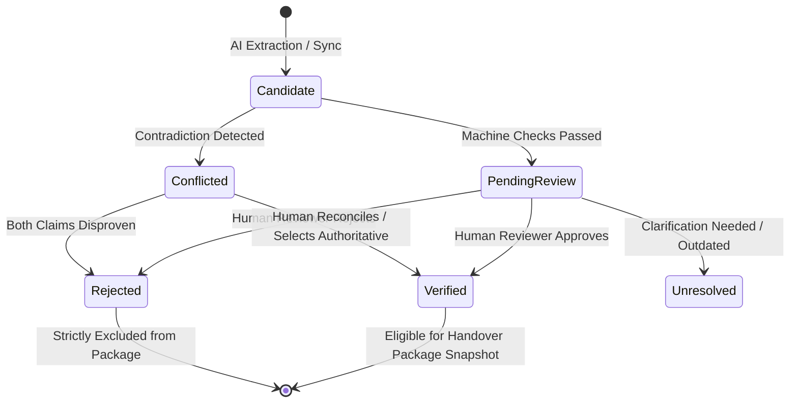

# HANDOVER WORKSPACE — PHASE 2 AUDIT
## Verification Overview, Epistemic Integrity & Knowledge Review Experience

**Audit Date**: 22 November 2026  
**Auditors**: Senior Enterprise Product Designer, UX Architect & Senior Frontend Engineer  
**Scope**: Handover Workspace (`/handovers/[id]`), Verification Center (`/verification`), Conflict Management (`/conflicts`), and underlying backend verification engines.  
**Platform Identity**: The Handover (Intelligent Project Knowledge Reconstruction & Handover Platform)  

---

## 1. Executive Summary

This audit establishes the factual baseline of the platform's verification, conflict, and epistemic tracking subsystems before executing Phase 2 UI and UX refinements.

The platform architecture rests on a non-negotiable **Four-Tier Epistemic Hierarchy**:
```text
Tier 1: Original Source Evidence  (Raw, immutable source records from Git, Jira, Docs, Slack)
           │
           ▼
Tier 2: Extracted Information     (Machine-extracted entities, statements, and timestamps)
           │
           ▼
Tier 3: AI-Generated Interpretation (Synthesized claims, confidence scores, uncertainty notes)
           │
           ▼
Tier 4: Human-Verified Knowledge  (Human-approved, attributable findings eligible for handovers)
```

### Core Audit Discoveries
1. **Actual Backend Status Model**:
   - `knowledge_items`: Database check constraint strictly enforces:
     - `epistemic_status`: `'extracted'`, `'ai_interpreted'`, `'human_verified'`
     - `review_status`: `'pending_review'`, `'approved'`, `'rejected'`, `'needs_clarification'`
     - `support_classification`: `'direct'`, `'corroborated'`, `'interpretation'`, `'uncertain'`
   - `verification_cases`: Database check constraint enforces:
     - `case_status`: `'candidate'`, `'pending_review'`, `'verified'`, `'conflicted'`, `'rejected'`, `'unresolved'`, `'archived'`
     - `priority`: `'low'`, `'medium'`, `'high'`, `'critical'`
     - `machine_assessment_status`: `'passed'`, `'flagged'`, `'needs_human_review'`, `'failed'`
   - `verification_conflicts`:
     - `resolution_state`: `'unresolved'`, `'open'`, `'under_investigation'`, `'awaiting_context'`, `'resolved'`, `'reconciled'`, `'superseded'`, `'dismissed'`, `'reopened'`
     - `conflict_type`: `'factual'`, `'temporal'`, `'scope'`, `'ownership'`, `'status'`
2. **Current Handover Workspace Gap**:
   - In `CanonicalSectionView.tsx`, Domain 1 contains an `Epistemic Integrity Gate` card that shows basic numeric counts (`human_verified_included`, `pending_verification`, `unresolved_conflicts`, `rejected + outdated`).
   - Clicking "Verify Findings" or clicking pending pills currently routes the user away from their active handover context to the standalone `/verification` route.
   - Users cannot inspect pending findings, read supporting excerpts, view opposing conflict claims, or execute approvals/rejections directly within their handover review workflow.
3. **Verification Integrity Safeguard**:
   - `HandoverReadinessEngine` (`backend/app/services/handover_readiness.py`) treats Verification as an independent gate (`verification_gate_passed`).
   - A handover with 87/100 readiness cannot be signed off if unverified candidate findings remain (`is_ready_for_signoff = False`).
   - The UI must visibly distinguish **operational readiness** from **epistemic verification completeness**.

---

## 2. Technical Inventory & Component Map

### A. Frontend Architecture
| Component / File | Purpose & Current State | Phase 2 Assessment |
| :--- | :--- | :--- |
| `frontend/src/components/handover/CanonicalSectionView.tsx` | Renders canonical domain sections, epistemic breakdown bar, and verified knowledge cards. | Needs replacement of the static Epistemic Integrity Gate card with a prominent **Verification Overview** component, plus direct review integration. |
| `frontend/src/components/verification/VerificationOverviewBar.tsx` | Top metrics bar on `/verification` showing candidate, pending, conflicted, unresolved, verified, rejected. | High-quality component; metrics and status mapping can be leveraged for the Handover Verification Overview. |
| `frontend/src/components/verification/FindingsQueuePanel.tsx` | Filterable list of findings in Verification Center. | Can be adapted into a focused, in-workspace **Pending Verification Queue**. |
| `frontend/src/components/verification/FindingWorkspacePanel.tsx` | Center/Right panel on `/verification` with deep evidence inspection, decision bar, and revisions. | Contains full support for approving, rejecting, editing, and requesting context; can be integrated into an in-workspace review drawer. |
| `frontend/src/components/verification/SideBySideConflictCard.tsx` | Displays opposing source claims side-by-side with timestamps and providers. | Excellent component for in-workspace conflict investigation. |
| `frontend/src/components/verification/EvidenceSourceDrawer.tsx` | Slide-over inspecting original cited chunk/evidence with author and access scope. | Ready for reuse when inspecting evidence excerpts. |
| `frontend/src/lib/verificationApi.ts` | Fully typed API client for summary, queue, cases, review actions, and edits. | Complete; supports `getSummary`, `getQueue`, `getCaseDetail`, `approveCase`, `rejectCase`, `editFinding`, `requestContext`, `markUnresolved`. |
| `frontend/src/lib/conflictsApi.ts` | Typed API client for conflict listings, metrics, and investigation notes. | Complete; supports conflict resolution workflows. |

### B. Backend Services & Endpoints
| Endpoint | Method | Backend Service & DB Models | Capability |
| :--- | :--- | :--- | :--- |
| `/projects/{pid}/verification/summary` | GET | `VerificationReviewService.get_project_summary` (`VerificationCase`) | Total cases, candidate, pending_review, conflicted, unresolved, verified, rejected. |
| `/projects/{pid}/verification/queue` | GET | `VerificationReviewService.list_queue` (`VerificationCase`) | Paginated, filterable queue with domain, category, status, search, reviewer. |
| `/projects/{pid}/verification/cases/{id}` | GET | `VerificationReviewService.get_case_detail` (`VerificationCase`, `VerificationEvidenceRef`) | Full finding payload, evidence references, issues, conflicts, revisions, audit events. |
| `/projects/{pid}/verification/cases/{id}/approve` | POST | `VerificationReviewService.approve_case` | Approves case, updates underlying `KnowledgeItem.review_status='approved'`, writes `VerificationReviewEvent`. |
| `/projects/{pid}/verification/cases/{id}/reject` | POST | `VerificationReviewService.reject_case` | Rejects case, updates underlying `KnowledgeItem.review_status='rejected'`, writes `VerificationReviewEvent`. |
| `/projects/{pid}/verification/cases/{id}/finding` | PATCH | `VerificationReviewService.edit_finding` | Creates immutable `VerificationFindingRevision`, updates claim, writes review event. |
| `/projects/{pid}/verification/cases/{id}/request-context` | POST | `VerificationReviewService.create_context_request` | Dispatches clarification question to project member. |
| `/projects/{pid}/conflicts/{id}` | GET | `ConflictService.get_conflict_detail` | Detailed comparison of opposing sources A and B. |

---

## 3. Epistemic Status & Transition Model

The backend supports deterministic state transitions validated by PostgreSQL transactions and audit trails:



### Transition Invariants
1. **Approval Authorization**: Only users with project member review permissions (`manager`, assigned reviewer, or authorized role) may approve or reject cases.
2. **Optimistic Locking**: Every review action passes the expected `version` integer to prevent race conditions or duplicate review actions.
3. **Audit Trail**: Every status transition generates an immutable `VerificationReviewEvent` containing `reviewer_user_id`, `action`, `previous_status`, `new_status`, and `decision_reason`.
4. **ACL Boundary Enforcement**: Evidence references check user access scope (`project_members`, `restricted`). If a reviewer lacks source access, `restricted_by_acl=True` and raw excerpt text is withheld to prevent permission bypass.

---

## 4. Identified UX & Architectural Deficiencies in Current Workspace

1. **Fragmented Navigation**:
   - When a user views the Eight-Domain Handover Matrix and sees "5 pending" in Decisions or "2 conflicts" in Architecture, clicking it forces a page navigation to `/verification` or `/conflicts`, tearing down their handover review context.
2. **Under-informative Epistemic Gate**:
   - The current `Epistemic Integrity Gate` card in Domain 1 is a static summary list with minimal context. It does not explain:
     - The calculation denominator (`verified / (verified + pending)`)
     - Why pending findings are unverified
     - How conflicts were identified
3. **Lack of In-Workspace Review Drawer**:
   - Reviewers must be empowered to review, approve, reject, or request context on pending items directly within the Handover Workspace without losing their place in the active version snapshot.
4. **Conflict Opacity**:
   - Conflicted claims are merely counted as a number (`unresolved_conflicts: 1`) without letting the user see what the opposing statements actually state.

---

## 5. Planned Phase 2 Implementations

### 1. `HandoverVerificationOverview.tsx`
- Redesign the current Epistemic Integrity Gate into a prominent, structured **Verification Overview** component.
- Display:
  - Total extracted findings in project scope
  - Human-verified findings included in handover package
  - Pending findings requiring human review
  - Unresolved cross-source conflicts
  - Rejected / outdated items excluded from package
- Visual hierarchy prioritizing:
  1. Pending findings requiring attention
  2. Verified knowledge eligible for handover
  3. Unresolved conflicts
  4. Rejected / outdated items
- Compact verification progress ring with clear formula: `verified / (verified + pending)` and explicit separation from operational readiness score.

### 2. `HandoverVerificationReviewDrawer.tsx`
- A focused in-workspace slide-over review interface:
  - Filter queue by domain (defaulting to the active tab or all domains), category, priority, and search.
  - Interactive finding review with:
    * Finding statement & domain
    * Source evidence with author, timestamp, provider, and ACL scope
    * AI interpretation badge, confidence score, and uncertainty notes
    * Action bar: Approve, Reject, Edit finding claim, Request context
  - Immediate state reflection and parent view refresh (`retryLoadSections`, `retryLoadReadiness`).

### 3. `HandoverConflictInspectionModal.tsx`
- Structured side-by-side inspection of conflicting findings:
  - Opposing claims A vs. B with source titles, authors, timestamps, and provider badges.
  - Reason for contradiction and temporal comparison.
  - Direct link or action to resolve with authoritative claim selection.

### 4. Integration into `CanonicalSectionView.tsx` and Navigation
- Replace the legacy Epistemic Integrity Gate card in Domain 1 with `HandoverVerificationOverview`.
- Connect the `EpistemicBreakdownBar` across Domains 2–8 so clicking "N pending verification" immediately opens the review drawer pre-filtered to that domain.
- Connect the Domain Coverage Matrix so clicking pending/conflict badges opens the focused review drawer.
