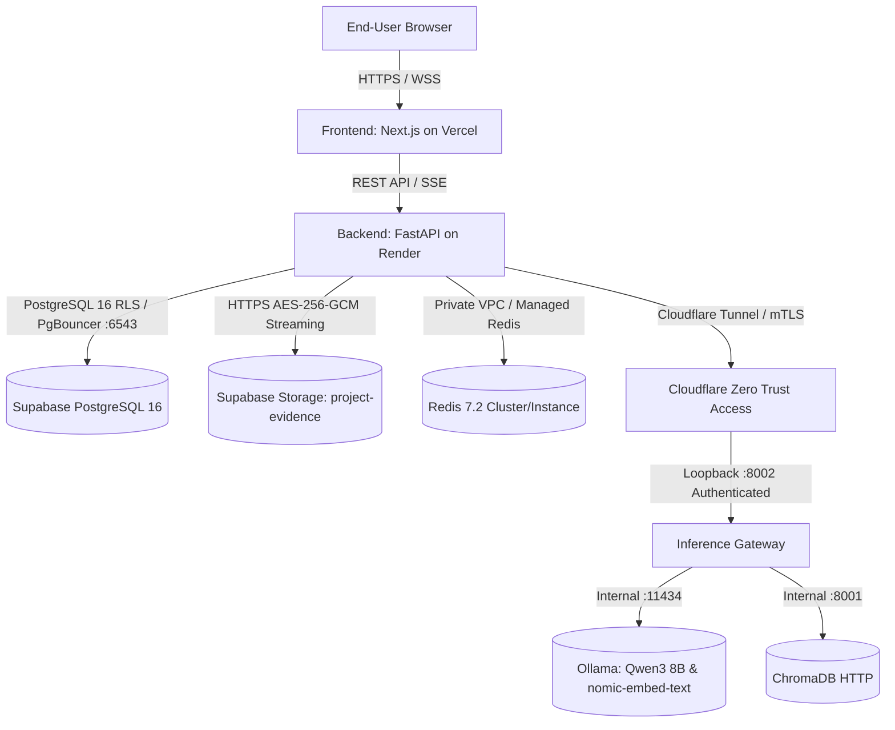

# PHASE AI-10.3: DEPLOYMENT ENGINEERING REPORT

**Status**: VERIFIED & REHEARSED  
**Date**: November 18, 2026  
**Auditor**: DevOps & Deployment Engineer  

---

## 1. Executive Summary

Phase AI-10.3 audited and verified the full multi-tier production deployment topology for **The Handover Project Intelligence Engine**:
1. **Frontend (Vercel)**: Next.js 16.4.6 with Turbopack, React 19, static prerendering across 69 routes, and API base URL fallback support.
2. **Backend API (Render)**: Python 3.11 with FastAPI, Uvicorn ASGI behind proxy headers, and decoupled background workers.
3. **Database & Storage (Supabase)**: Managed PostgreSQL 16 (65 RLS-secured tables, migration revision 0020) and private bucket storage (`project-evidence`) with client-side envelope encryption.
4. **AI Inference Gateway & Ingress Strategy**: Cloudflare Tunnel / Cloudflare Access reverse proxy architecture securely connecting the Render API to private Ollama/hardware inference runtimes without public IP exposure.

---

## 2. Component Deployment Topology

---

## 3. Frontend Verification (Vercel)

- Build pipeline verified via `npm run build`:
  - Compiled successfully with zero TypeScript or styling errors.
  - Generated all **69 application routes** (including `/projects/[id]/assistant`, `/handovers/[id]/review`, and `/verification`).
- Configuration invariants:
  - `NEXT_PUBLIC_API_BASE_URL` dynamically points to the Render backend service or respects same-origin rewrites.
  - Zero sensitive secrets exposed via client bundles (only public keys like `NEXT_PUBLIC_SUPABASE_ANON_KEY`).

---

## 4. Backend Verification (Render)

- `render.yaml` infrastructure-as-code specification:
  - **Service**: `the-handover-api` (Web service, Python runtime, region: `singapore`).
  - **Start Command**: `uvicorn app.main:app --host 0.0.0.0 --port $PORT --workers 1 --proxy-headers --forwarded-allow-ips='*'`
  - **Health Check Path**: `/health` (verified returning HTTP 200).
  - **Readiness Path**: `/health/ready` (probes PostgreSQL, Redis, ChromaDB, Ollama).

---

## 5. Inference Gateway & Cloudflare Tunnel Architecture

- Ollama (`:11434`) and ChromaDB (`:8001`) are bound to private interfaces.
- For cloud deployment where the API runs on Render and GPU inference runs on high-performance hardware:
  - Cloudflare Tunnel (`cloudflared`) establishes an outbound-only encrypted tunnel to Cloudflare Edge.
  - Render communicates via HTTPS through Cloudflare Service Tokens (`CF-Access-Client-Id` / `CF-Access-Client-Secret`).
  - Zero incoming ports are opened on the inference host firewall.
