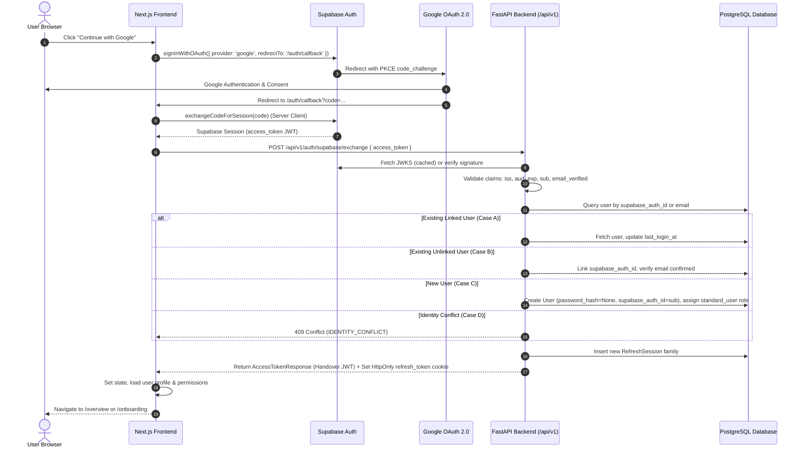

# Architecture Specification: Google Sign-In via Supabase Auth & FastAPI Identity Exchange

## Overview & Mission
This document details the architectural boundaries, token lifecycles, and cryptographic identity exchange mechanism for Google Sign-In within **The Handover** platform.

The system implements an **Identity Exchange Pattern**:
```text
Google OAuth (PKCE) ──▶ Supabase Auth ──▶ Verified Identity Exchange ──▶ FastAPI Session & JWTs ──▶ Handover Application Access
```

---

## 1. Core Principle & Authority Boundaries

1. **FastAPI-Managed Authority**:
   - The platform identity authority is **FastAPI**.
   - FastAPI issues application access tokens, manages Argon2id password hashes, maintains SHA-256 refresh token families in `refresh_sessions`, rotates tokens on usage, detects reuse, and enforces PostgreSQL RBAC, organisation/project boundaries, and source-level ACLs.
2. **Supabase Auth as Delegated Identity Provider**:
   - Supabase Auth acts solely as the OAuth broker for authenticating Google identity.
   - Supabase Auth issues an identity token (JWT) to the client upon successful PKCE exchange.
3. **Identity Exchange Boundary**:
   - The client never uses the Supabase JWT to directly access Handover API endpoints or bypass FastAPI RBAC.
   - The Supabase JWT is submitted to `POST /api/v1/auth/supabase/exchange`.
   - FastAPI cryptographically validates the token via Supabase JWKS (asymmetric) or HMAC secret (symmetric) before provisioning an application session.

---

## 2. Sequence Diagram



---

## 3. Four-Tier Identity Resolution Policy

| Case | Condition | Action |
| :--- | :--- | :--- |
| **Case A — Linked User** | User exists with matching `supabase_auth_id`. | Authenticate immediately, create Handover refresh session, update `last_login_at`. |
| **Case B — Unlinked User** | User exists with matching email, but `supabase_auth_id` is null. | Check that Google/Supabase email is confirmed. If verified, set `supabase_auth_id = sub` and record `auth.supabase.link` audit event. If Google email is unverified, reject with 401 `UNVERIFIED_EMAIL`. |
| **Case C — New User** | No user with email or `supabase_auth_id`. | Create user record with `supabase_auth_id = sub`, `password_hash = None`, `is_email_verified = True`. Assign platform `standard_user` role. Do NOT grant organisation or project access. Record `auth.supabase.register` audit event. |
| **Case D — Conflict** | `supabase_auth_id` points to User A, but email belongs to User B. | Reject with 409 `IDENTITY_CONFLICT`. Log security warning event. Prevent account takeover. |

---

## 4. Application Session Preservation

- **Access Token**: Short-lived JWT (15 minutes default) signed by Handover's own `JWT_SECRET_KEY`.
- **Refresh Token**: Opaque 256-bit token delivered exclusively in an `HttpOnly`, `SameSite=lax`, `Secure` cookie named `refresh_token`.
- **Rotation**: Standard rotation cycle at `POST /api/v1/auth/refresh` with SHA-256 digests in `refresh_sessions`. Family revocation occurs if a revoked or reused refresh token is presented.
- **Logout**: `POST /api/v1/auth/logout` revokes the Handover session family in PostgreSQL, clears the `refresh_token` cookie, and signs out of the Supabase browser client.
