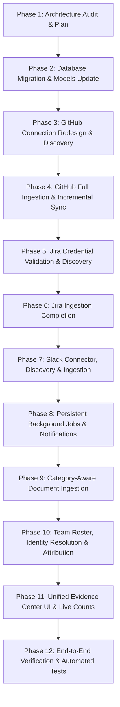
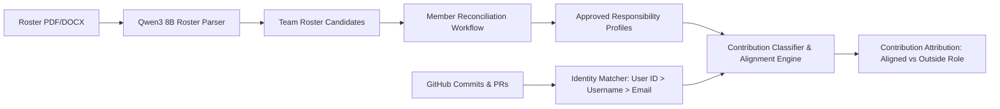

# Connected Sources & Evidence Center — Implementation Plan

**Platform**: The Handover (Intelligent Project Knowledge Reconstruction & Handover Platform)  
**Modules**: Connected Sources, Evidence Center, GitHub, Jira, Slack, Document Ingestion, Team Identity Intelligence  
**Date**: November 2026  
**Status**: Approved Phased Implementation Blueprint  

---

## 1. Architectural Strategy & Core Tenets

1. **Backend-First & Zero Fabrication**:
   - Every connection, repository, Jira project, Slack channel, and document must originate from genuine credentials or uploaded files.
   - All external credentials must be encrypted using AES-256-GCM before database storage and never returned to the frontend.
2. **Fail-Closed Pre-Retrieval ACLs**:
   - Project membership does not equal source access. A user connecting a private repository or Jira project does not automatically grant other project members permission to view or retrieve its raw contents unless explicitly authorised.
3. **Canonical PostgreSQL Ledger & Secondary ChromaDB HTTP Vectors**:
   - PostgreSQL stores all evidence records, chunks, provenance metadata, jobs, notifications, and identity mappings.
   - Exactly one ChromaDB collection per project (`{prefix}_project_{project_id}`) stores vectors produced by `nomic-embed-text`.
4. **Decoupled Background Execution**:
   - Synchronisation and heavy extraction jobs run in the PostgreSQL-backed worker process. Users can navigate across any page while jobs proceed uninterrupted.
   - The frontend application shell tracks active jobs globally and displays notifications upon completion or failure.

---

## 2. Phased Implementation Sequence

---

## 3. Database Schema Extensions & Migration (Phase 2)

### 3.1 Migration `20261116_0019_connected_sources_and_evidence.py`
1. **Extend Integration Providers**:
   - Update `source_connections`, `oauth_states`, `source_access_policies`, `project_source_mappings`, and `source_sync_runs` check constraints:
     - Allow `provider IN ('github', 'jira', 'slack')`
     - Allow `resource_type IN ('github_repository', 'jira_project', 'slack_channel')`
     - Allow `authorisation_mode IN ('delegated_per_user', 'bot_token', 'oauth_v2')`
2. **Add Document Categories to `evidence_items`**:
   - Add columns:
     - `document_category VARCHAR(64) NULL` (e.g. `team_roster`, `meeting_notes`, `project_document`)
     - `document_subtype VARCHAR(64) NULL` (e.g. `prd`, `srs`, `trd`, `dd`, `add`, `api_spec`, `db_design`, `runbook`, `other`)
   - Expand `category` check constraint on `evidence_items` to include `'team_roster'`, `'meeting_notes'`, `'project_document'`, `'source_code'`.
3. **Create `notifications` Table**:
   - `id UUID PRIMARY KEY DEFAULT gen_random_uuid()`
   - `organisation_id UUID NOT NULL REFERENCES organisations(id) ON DELETE CASCADE`
   - `project_id UUID NULL REFERENCES projects(id) ON DELETE CASCADE`
   - `user_id UUID NOT NULL REFERENCES users(id) ON DELETE CASCADE`
   - `type VARCHAR(32) NOT NULL` (`source_sync_completed`, `source_sync_partial`, `source_sync_failed`, `document_processed`, `review_required`)
   - `title VARCHAR(255) NOT NULL`
   - `body TEXT NOT NULL`
   - `metadata_json JSONB NOT NULL DEFAULT '{}'` (holds `records_imported`, `records_updated`, `records_failed`, `source_provider`, `link`)
   - `read BOOLEAN NOT NULL DEFAULT FALSE`
   - `created_at TIMESTAMPTZ NOT NULL DEFAULT NOW()`
   - Indices: `(user_id, read)`, `(project_id, created_at)`
4. **Create `team_roster_members` Table** (Extracted Roster Candidates & Reconciled Profiles):
   - `id UUID PRIMARY KEY DEFAULT gen_random_uuid()`
   - `project_id UUID NOT NULL REFERENCES projects(id) ON DELETE CASCADE`
   - `evidence_item_id UUID NOT NULL REFERENCES evidence_items(id) ON DELETE CASCADE`
   - `external_member_id VARCHAR(128) NULL`
   - `full_name VARCHAR(255) NOT NULL`
   - `email VARCHAR(255) NULL`
   - `team VARCHAR(128) NULL`
   - `designation VARCHAR(128) NULL`
   - `project_role VARCHAR(128) NULL`
   - `responsibilities TEXT NULL`
   - `technical_domains JSONB NOT NULL DEFAULT '[]'`
   - `components_handled JSONB NOT NULL DEFAULT '[]'`
   - `github_username VARCHAR(128) NULL`
   - `git_commit_email VARCHAR(255) NULL`
   - `jira_account_id VARCHAR(128) NULL`
   - `slack_user_id VARCHAR(64) NULL`
   - `reconciliation_status VARCHAR(32) NOT NULL DEFAULT 'pending'` (`pending`, `matched`, `candidate`, `ambiguous`, `conflict`, `rejected`)
   - `matched_project_membership_id UUID NULL REFERENCES project_memberships(id) ON DELETE SET NULL`
   - `raw_excerpt TEXT NULL`
   - `created_at TIMESTAMPTZ NOT NULL DEFAULT NOW()`
   - `updated_at TIMESTAMPTZ NOT NULL DEFAULT NOW()`
5. **Create `contribution_attributions` Table**:
   - `id UUID PRIMARY KEY DEFAULT gen_random_uuid()`
   - `project_id UUID NOT NULL REFERENCES projects(id) ON DELETE CASCADE`
   - `evidence_item_id UUID NOT NULL REFERENCES evidence_items(id) ON DELETE CASCADE`
   - `source_provider VARCHAR(32) NOT NULL` (`github`, `jira`, `slack`)
   - `source_external_id VARCHAR(255) NOT NULL` (e.g. `commit:sha`, `pr:number`)
   - `author_name VARCHAR(255) NULL`
   - `author_email VARCHAR(255) NULL`
   - `author_login VARCHAR(128) NULL`
   - `committer_name VARCHAR(255) NULL`
   - `committer_email VARCHAR(255) NULL`
   - `committer_login VARCHAR(128) NULL`
   - `verified_project_member_id UUID NULL REFERENCES project_memberships(id) ON DELETE SET NULL`
   - `identity_match_method VARCHAR(64) NOT NULL` (`github_id`, `verified_username`, `commit_email`, `noreply_email`, `cross_provider_alias`, `unverified_candidate`, `unmatched`)
   - `contribution_category VARCHAR(64) NOT NULL` (`Frontend Development`, `Backend Development`, `Database Engineering`, `API Development`, `Authentication`, `AI/ML`, `RAG and Retrieval`, `OCR and Document Processing`, `Infrastructure`, `DevOps`, `Testing`, `Documentation`, `Bug Fixing`, `Security`, `UI/UX`, `Integration`, `Other`)
   - `responsibility_alignment VARCHAR(32) NOT NULL` (`ALIGNED`, `PARTIALLY_ALIGNED`, `OUTSIDE_DECLARED_RESPONSIBILITY`, `UNCERTAIN`, `NOT_APPLICABLE`)
   - `alignment_explanation TEXT NULL`
   - `created_at TIMESTAMPTZ NOT NULL DEFAULT NOW()`

---

## 4. GitHub Connection & Ingestion Architecture (Phases 3 & 4)

### 4.1 Connection & Dynamic Discovery Workflow
1. User opens modal and selects **GitHub**.
2. User provides Fine-Grained Personal Access Token (PAT) and optional display name.
3. Frontend calls `POST /api/v1/integrations/github/validate-and-discover`.
4. Backend:
   - Queries `GET https://api.github.com/user` to verify identity and scopes.
   - Queries `GET https://api.github.com/user/repos?per_page=100&sort=updated` (with pagination).
   - Returns sanitized authenticated user identity, rate-limit status, and list of `GitHubRepositoryCandidate`.
   - Encrypts PAT using AES-256-GCM and stores or updates `SourceConnection` and `UserSourceAuthorisation`.
5. Frontend transitions to Step 2: **Repository Selector**:
   - Search by repo name, filter by public/private, sort by updated date.
   - Checkbox selection (single or multi-select).
   - Confirmation button: "Map Selected Repositories".
6. Frontend calls `POST /api/v1/projects/{project_id}/integrations/github/mappings` with selected repo full names.
7. User is offered `Start Initial Sync` (spawns background sync job returning `202 Accepted`).

### 4.2 Ingestion Coverage & Separate Author/Committer Tracking
- **Repository metadata**: full name, default branch, visibility, description, URL.
- **Documentation**: root `README.md`, `/docs`, `.md`, `.mdx`, architecture diagrams.
- **Commits**: full commit history metadata with **separate author and committer fields**:
  - `git_author_name`, `git_author_email`, `github_author_login`
  - `git_committer_name`, `git_committer_email`, `github_committer_login`
  - SHA, message, timestamps, changed file names, patches where available.
- **Pull Requests**: number, title, description, author, reviewers, state, comments, review comments, changed files, merge SHA.
- **Issues**: number, title, body, author, state, labels, assignees, milestone, comments.
- **Optional Source Code Indexing**: scope toggle `include_code_files=True` with strict file size (<200KB) and extension allowlist, ignoring `node_modules`, `.env`, secrets, and binaries.
- **Checkpoints**: incremental sync stores `last_commit_sha`, `last_issue_updated_at`, `last_pr_updated_at` in `ProjectSourceMapping.sync_cursor_json`.

---

## 5. Jira Credential Validation & Discovery (Phases 5 & 6)

### 5.1 Credential Options & Validation
- **Option A**: Atlassian OAuth 2.0 3LO (preferred when configured).
- **Option B**: Atlassian API Token (Site URL + Email + API Token).
- **SSRF Validation**: Jira Site URL must be validated against `*.atlassian.net` or approved domains, strictly rejecting private IP ranges (10.0.0.0/8, 172.16.0.0/12, 192.168.0.0/16, 127.0.0.1, etc.).
- **Validation**:
  - `GET https://{site}/rest/api/3/myself` validates identity.
  - `GET https://{site}/rest/api/3/project/search` discovers all accessible Jira projects.
  - Return selectable list: `Project name`, `Key`, `ID`, `Type`, `Lead`, `URL`.
- **Remove Manual Project Key Field**: User selects Jira projects from the discovered list.

### 5.2 Ingestion Scope
- Issues, summaries, descriptions (converting Atlassian Document Format to Markdown).
- Comments with author and timestamps.
- Changelogs: status transitions, assignment changes.
- Relationships: parent/child, subtasks, issue links (`blocks`, `is blocked by`, `relates to`).
- Incremental sync checkpoints using `updated >= cursor_timestamp`.

---

## 6. Slack Integration Architecture (Phase 7)

### 6.1 Connector & Discovery
- **Connection**:
  - Mode A: Slack OAuth v2 (`SLACK_CLIENT_ID`, `SLACK_CLIENT_SECRET`).
  - Mode B: Authorised Bot User OAuth Token (`xoxb-...`).
- **Validation**:
  - `POST https://slack.com/api/auth.test` verifies bot identity and workspace.
  - `GET https://slack.com/api/team.info` verifies team domain and name.
  - `GET https://slack.com/api/conversations.list?types=public_channel,private_channel` lists accessible channels where bot is a member.
- **Channel Selector UI**:
  - Displays channel name, ID, public/private badge, member count, topic.
  - User selects channels to map to the project.

### 6.2 Slack Ingestion & Threading
- `conversations.history` fetches channel messages.
- `conversations.replies` fetches complete threaded conversations preserving parent-child message hierarchy.
- Normalizes into `EvidenceItem` with `source_type='slack'`, `category='discussion_thread'`.
- Respects Slack rate limits (Tier 3: 50+ requests/min) with exponential backoff and cursor checkpoints.

---

## 7. Persistent Background Tasks & Global Notifications (Phase 8)

### 7.1 Cross-Page Task Continuity
1. Starting sync queues a `BackgroundJob` of type `source_sync`.
2. Fast response: HTTP 202 with `job_id`, `mapping_id`, and initial status `QUEUED`.
3. Worker process claims the job and executes pipeline:
   `QUEUED -> VALIDATING -> FETCHING -> NORMALISING -> PERSISTING -> CHUNKING -> EMBEDDING -> INDEXING -> COMPLETED`.
4. Frontend `SyncTaskProvider` in `AppLayout.tsx`:
   - Polls active jobs every 5 seconds while jobs are in flight; backs off to 30s when idle.
   - Survives browser navigation and refresh.
   - Top navigation shows active sync spinner and count badge. Clicking opens a dropdown task panel with real progress counts.
5. On completion or failure:
   - Worker writes a record to `notifications` table.
   - `SyncTaskProvider` receives update, triggers in-app toast, and bumps global unread notification badge.

---

## 8. Document Category Architecture (Phase 9)

### 8.1 Category-Aware Upload Flow
`UploadDocumentModal.tsx` provides three distinct cards:
1. **Team Roster & Member Responsibilities**:
   - Upload PDF/DOCX listing team members, designations, project roles, responsibilities, GitHub/Jira/Slack handles.
   - Triggers `RosterExtractionService` upon upload.
2. **Meeting Notes**:
   - Upload meeting minutes, agenda notes, and discussion transcripts.
   - Triggers `MeetingNotesExtractionService` to separate discussed topics from agreed decisions and action items.
3. **Project Documents**:
   - Subtypes dropdown: PRD, SRS, TRD, DD (Design Document), ADD (Architecture Design Document), API Specification, Database Design, Test Plan, Operations Runbook, Other.
   - Triggers subtype-specific structured extraction into Knowledge Intelligence domains.

---

## 9. Team Roster Extraction, Identity Resolution & Attribution (Phase 10)

### 9.1 Roster Extraction Pipeline
1. Extract digital text via PyMuPDF or python-docx (falling back to GLM OCR only for image-based scanned pages).
2. Qwen3 8B receives raw table/text content and extracts structured `RosterMemberCandidate` objects:
   - `full_name`, `email`, `team`, `designation`, `project_role`, `responsibilities`, `components_handled`, `github_username`, `git_commit_email`, `jira_account_id`, `slack_user_id`.
3. Persists candidates in `team_roster_members` with status `pending`.

### 9.2 Human-in-the-Loop Member Reconciliation
- Admin or Project Manager reviews candidates in **Panel C: Member Mapping** tab.
- Actions: Match to existing member, Invite new member, Edit fields, Approve, Reject.
- On approval, updates `project_memberships.responsibility_description` and records aliases in `entity_aliases`.

### 9.3 GitHub Contribution Attribution & Responsibility Alignment
1. **Identity Resolution**: For each ingested commit, extract Git author email, committer email, and GitHub login. Match against project members using strict priority.
2. **Domain Classification**: Classify commit/PR into technical categories (Backend, Frontend, DB, Security, etc.) using commit message and changed file paths.
3. **Responsibility Alignment**: Compare contribution category against the verified member's declared responsibilities:
   - `ALIGNED`: Commit is within declared responsibilities.
   - `PARTIALLY_ALIGNED`: Related or cross-cutting component.
   - `OUTSIDE_DECLARED_RESPONSIBILITY`: Member contributed to a different area (recorded analytically, not as an error).
   - `UNCERTAIN`: Insufficient declared context.

---

## 10. Unified Evidence Center UI & Live Counts (Phase 11 & 13)

1. **Card Display in Connected Sources**:
   - 4 live cards: **GitHub**, **Jira**, **Slack**, **PDF & DOCX Uploads**.
   - Confluence and Google Drive cards displayed with prominent **"Planned Integration"** badge and disabled connect buttons.
   - All record counts, selected resource counts, and sync states fetched from real backend APIs.
2. **Evidence Center 3-Panel Layout**:
   - **Panel A**: Authorised connected sources and resource mappings with live status badges.
   - **Panel B**: Evidence library with category filters (Team Roster, Meeting Notes, PRD, TRD, DD, GitHub, Jira, Slack), search, author, and pagination.
   - **Panel C**: Three existing tabs (Source Record, Facts, Findings) plus a new **Member Mapping** tab when viewing a Team Roster document.

---

## 11. Verification & Automated Quality Gates (Phase 12 & 14)

1. **Backend Tests**:
   - New unit and integration tests for GitHub PAT discovery, Jira discovery, Slack discovery and sync, Roster extraction, Identity attribution, and Notifications.
   - Alembic check (`alembic check`).
   - Pytest test execution.
2. **Frontend Quality**:
   - TypeScript strict check (`npm run build`).
3. **Live Process Check**:
   - Verify all 3 background processes (FastAPI backend, Worker, Next.js frontend) run cleanly with zero unhandled exceptions.
