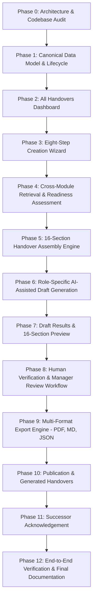

# Handover Workspace — Phased Implementation Plan

**Platform**: The Handover  
**Formal Product Description**: Intelligent Project Knowledge Reconstruction & Handover Platform  
**Module**: Handover Workspace (Module 4 / Knowledge Transfer Area) & Generated Handovers  
**Status**: Active Execution Plan  
**Date**: 2026-11-17  

---

## 1. Architectural Principles & Scope Boundaries

1. **Backend-First Implementation**: Build complete backend services, models, migrations, schemas, repositories, and REST APIs before modifying Next.js frontend components.
2. **Package Compilation != Ownership Transfer**: Generating a package snapshot and altering project permissions are strictly isolated operations. Ownership transfer requires prior approval and acknowledgement.
3. **Immutable Version Snapshots**: Package versions are the central transactional unit. Once compiled, a version cannot be modified; modifications require a new version assembly.
4. **Four-Tier Epistemic Separation**: Extracted → AI-Interpreted → Human-Verified. Only human-verified knowledge enters released handover packages.
5. **Separation of Duties**: Departing members cannot approve their own handover packages as reviewers.
6. **No Fabricated Data**: Zero synthetic test data represented as genuine source evidence.
7. **16-Section Export Architecture**: Output synthesizes the 10 Handover Workspace sections into 16 core PDF sections with ASCII diagrams, tables, and verifiable evidence citations.
8. **Role-Specific Handover Profiles**: Support Developer, Project Manager, and Technical Lead tailored presentation profiles while keeping underlying verified facts identical.

---

## 2. Implementation Phases & Execution Sequence

---

## 3. Detailed Phase Specifications

### Phase 1: Canonical Handover Data Model & Lifecycle
- Verify and maintain 14 PostgreSQL tables in `backend/app/models/handover.py`.
- Enforce strict 14-state machine transitions in `HandoverCaseService`.
- Support role-specific handover type (`developer`, `project_manager`, `technical_lead`) stored in `HandoverCase.metadata_json["handover_type"]`.

### Phase 2: All Handovers Dashboard
- Live metric cards: In Progress, Pending Review, Published, Completed.
- Seven status filter tabs: All, Draft, In Progress, Pending Review, Approved, Published, Completed.
- Project selector, search by code/person/scope, table view, cards view, empty state.

### Phase 3: Eight-Step Creation Wizard
- Step 1: Project (active project selection with member/source counts).
- Step 2: Members (outgoing and incoming members with validation that outgoing != incoming).
- Step 3: Sources (scoped selection of connected repositories, Jira projects, Slack channels, and documents).
- Step 4: Scope (role profile: Developer, Project Manager, Technical Lead; date range, knowledge scope, verification scope, evidence inclusion).
- Step 5: Review (pre-generation readiness evaluation across project, evidence, knowledge, relationship, and section readiness).
- Step 6: Generate (background job dispatch with live progress indicators).
- Step 7: Results (preview of 16 PDF sections / 10 workspace sections with citations and validation report).
- Step 8: Submit (confirmation and submission to review workflow).

### Phase 4: Cross-Module Retrieval & Readiness Assessment
- Query upstream modules:
  - Evidence Center (evidence items, sources, original filenames, hashes, URLs).
  - Knowledge Intelligence (approved knowledge items across 8 domains).
  - Relationship Explorer (entities: persons, components, clusters; relationships: `contributed_to`, `depends_on`, `implements`).
  - Verification Center (verified cases, issues, conflicts, reviewer signoffs).
- 9-category readiness evaluation scoring (0-100), levels, blockers, and warnings.

### Phase 5: 16-Section Handover Assembly Engine
- Map 10 workspace sections into 16 core PDF sections:
  1. Executive Summary
  2. Project Overview, Objectives & Scope
  3. Current Project Status
  4. Product Features & User Workflows
  5. Technology Stack
  6. System Architecture & Integrations (with ASCII/text architecture diagram)
  7. Important Technical & Product Decisions
  8. Team Members, Responsibilities & Ownership (with ownership matrix)
  9. Workstreams & Contribution History (with contributor breakdown)
  10. Project Timeline & Milestones (with chronological timeline)
  11. Dependencies & Impact Analysis
  12. Operational Setup, Deployment & Maintenance
  13. Outstanding Tasks & Next Steps
  14. Risks, Blockers & Open Questions
  15. Verification, Conflicts & Knowledge Gaps (verification summary & open items disclosure)
  16. Evidence Sources & References (with `[E001]`, `[E002]` stable citation identifiers)
  + Appendix: Detailed Evidence & Contribution Records
- Generate stable citation references (`[E001]`, `[E002]`, etc.) for every important factual statement.

### Phase 6: Role-Specific AI-Assisted Draft Generation
- Apply role profiles:
  - `developer`: Architecture, tech stack, codebase/APIs, runbooks, technical dependencies.
  - `project_manager`: Goals, status, features, scope, milestones, responsibilities, risks, outstanding work.
  - `technical_lead`: Architecture, tech choices, system interactions, security, tech debt, component dependencies.
- Ensure Qwen3 8B drafting is strictly constrained to approved underlying facts with fallback to deterministic assembly if inference is unavailable.

### Phase 7: Draft Results & 16-Section Preview
- Full multi-section preview in frontend with section tabs.
- Citation inspection popover linking directly to supporting evidence.
- Downloadable preview PDF, Markdown, and JSON.
- Version history preservation.

### Phase 8: Human Verification & Manager Review Workflow
- Phase 1 signoff: Departing member context confirmation.
- Phase 2 signoff: Authorized reviewer / project manager formal approval.
- Correction request workflow: Return to draft with reviewer feedback.
- Release gate: Block publication until Phase 2 approval is granted.

### Phase 9: Multi-Format Export Engine
- PDF: Multi-page PyMuPDF rendering with cover page, ToC, headers/footers, page numbering, section tables, ASCII architecture diagram, and appendix.
- Markdown: Clean GFM format with ToC, tables, citations, and blockquotes.
- JSON: Machine-readable validated schema.
- Stamping: `[PREVIEW DRAFT - UNAPPROVED]` watermark on all unapproved packages.

### Phase 10: Publication & Generated Handovers
- Published Handovers page (`/generated-handovers`, `/handovers/published`):
  - Displays published packages, successor acknowledgement state, filters, view PDF, view acknowledgement.
  - Empty state with buttons: "Go to Handover Workspace" and "Create new handover".

### Phase 11: Successor Acknowledgement
- Phase 3 signoff: Incoming successor signs receipt with cryptographic confirmation hash.
- Status advances to `ACKNOWLEDGED` / `COMPLETED`.

### Phase 12: End-to-End Verification & Final Documentation
- Run automated backend test suite (`backend/tests/run_handover_workspace_audit.py`).
- Produce final documentation and reports:
  - `handover-implementation-report.md`
  - `handover-end-to-end-test-results.md`
  - `handover-export-validation.md`
