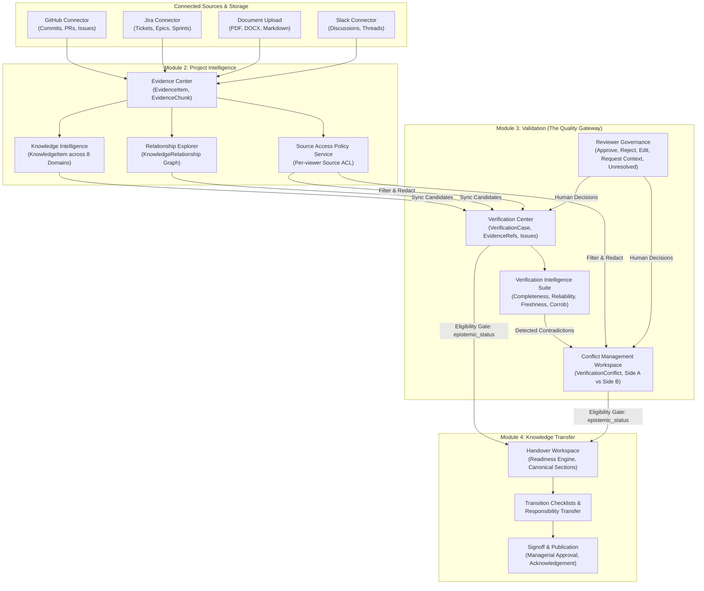
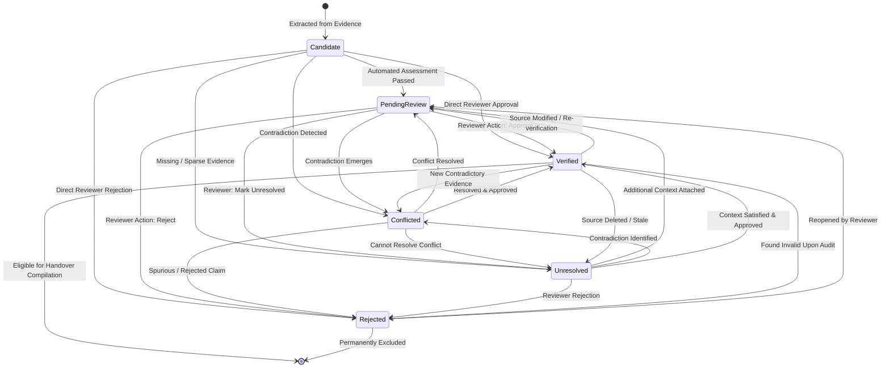
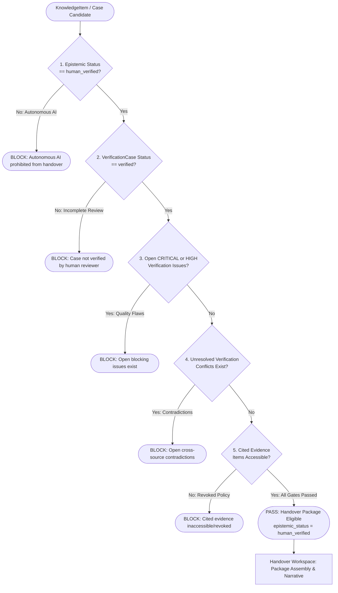
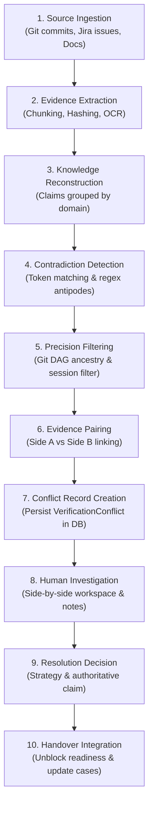
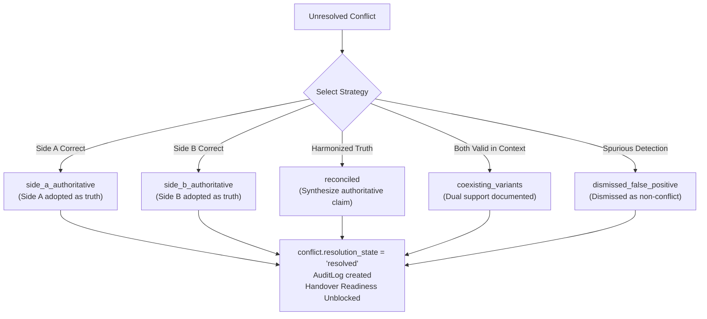
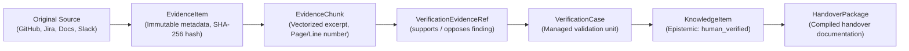
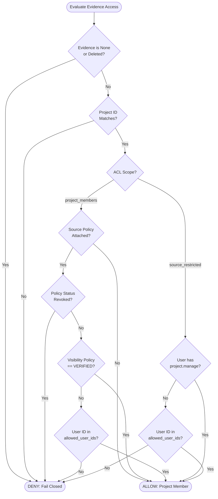
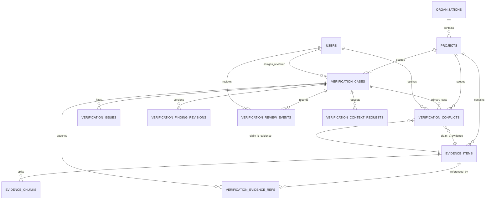

# The Handover Platform: Verification Center & Conflict Management Engineering Handbook

**Document**: Comprehensive Architecture, Intelligence Algorithms, Lifecycle Governance, Security Controls, and Developer Reference  
**Platform**: The Handover — Intelligent Project Knowledge Reconstruction & Handover Platform  
**Modules**: Module 3 (Validation Area) — Verification Center & Conflict Management  
**Version**: 1.0.0 (Post-Stage-8A Baseline)  
**Date**: 2026-11-18  
**Classification**: Internal Technical Product & Engineering Reference  
**Authors**: Core Platform Engineering & Verification Architecture Team  

---

## Executive Summary

Large Language Models (LLMs) and heuristic extractors applied to raw organisational evidence (code repositories, issue trackers, document repositories, and communication channels) excel at identifying patterns and synthesizing summaries. However, **AI cannot independently be trusted as an authority on project truth**. LLMs hallucinate non-existent dependencies, extrapolate outdated design documents, overlook subtle codebase revisions, conflate multi-contributor commits with sole ownership, and cannot reliably arbitrate between contradictory technical directives.

In **The Handover**, project knowledge governance is founded on an uncompromising principle: **No AI-generated finding is ever permitted to enter an approved handover package without human verification and explicit evidence grounding.**

To realize this principle, the platform provides two tightly integrated, specialized workspaces within the **Validation** navigation area:
1. **Verification Center**: A human-in-the-loop quality control center where candidates extracted by AI or reconstructed across the eight canonical project domains are grounded against primary source evidence, evaluated across multidimensional intelligence vectors (Completeness, Reliability, Freshness, and Corroboration), and reviewed by authorized human reviewers through a strictly audited five-action governance lifecycle.
2. **Conflict Management**: A dedicated investigative workspace designed to identify, isolate, classify, and arbitrate contradictory claims, architectural divergence, status discrepancies, and competing ownership assertions across disparate organisational sources.

Together, these two subsystems prevent knowledge leakage, eliminate false confidence, preserve verifiable provenance back to original documents and commit SHAs, and guarantee that incoming successors inherit a factual, verified, and conflict-free handover repository.

---

## Feature Implementation Status Matrix

The following table documents the verified implementation and testing status across the Verification Center and Conflict Management subsystems as of the November 2026 Post-Stage-8A baseline.

| Subsystem / Feature | Backend Service / Engine | Frontend Component / Route | Database Table / Migration | Test Suite Coverage | Verified Status |
| :--- | :--- | :--- | :--- | :--- | :--- |
| **Verification Findings Ingestion & Sync** | `VerificationEngine.sync_project_findings` | `useVerificationActions.sync` (`POST /sync`) | `verification_cases`, `verification_evidence_refs` (`0020`) | `test_verification_center.py`, `test_verification_security_e2e.py` | **Fully implemented and tested** |
| **Evidence Completeness Intelligence** | `CompletenessEvaluator` (0.0–1.0 score, 4 tiers) | `FindingWorkspacePanel.tsx`, `HandoverEligibilityBadge.tsx` | `verification_cases.evidence_completeness` (`0020`) | `test_advanced_verification_intelligence.py` | **Fully implemented and tested** |
| **Source Reliability Assessment** | `SourceReliabilityEvaluator` (Domain affinities) | `FindingWorkspacePanel.tsx` (Authority badge) | `verification_cases.machine_assessment_json` (`0020`) | `test_advanced_verification_intelligence.py` | **Fully implemented and tested** |
| **Freshness & Supersession Intelligence** | `FreshnessEvaluator` (90/180-day thresholds) | `FindingWorkspacePanel.tsx` (Freshness badge) | `verification_cases.machine_assessment_json` (`0020`) | `test_advanced_verification_intelligence.py` | **Fully implemented and tested** |
| **Independent Corroboration Evaluation** | `CorroborationEvaluator` (Distinct doc vs chunk) | `SupportingEvidencePanel.tsx`, `FindingWorkspacePanel.tsx` | `verification_cases.machine_assessment_json` (`0020`) | `test_advanced_verification_intelligence.py` | **Fully implemented and tested** |
| **Verification Recommendations & Priorities** | `RecommendationEngine`, `PrioritisationEngine` | `FindingsQueuePanel.tsx`, `FindingWorkspacePanel.tsx` | `verification_cases.priority`, `machine_assessment_json` | `test_advanced_verification_intelligence.py` | **Fully implemented and tested** |
| **Contradiction Detection Within Verification** | `AdvancedContradictionEvaluator` (6 categories) | `SideBySideConflictCard.tsx`, `FindingWorkspacePanel.tsx` | `verification_cases.machine_assessment_json` (`0020`) | `test_advanced_verification_intelligence.py` | **Fully implemented and tested** |
| **Reviewer Actions (Approve, Reject, Unresolved)** | `VerificationReviewService` (Actions 1, 2, 5) | `ReviewerActionPanel.tsx`, `useVerificationActions.ts` | `verification_review_events`, `verification_cases` | `test_verification_center.py`, `test_verification_security_e2e.py` | **Fully implemented and tested** |
| **Finding Editing & Versioned Revisions** | `VerificationReviewService.edit_finding` (Action 3) | `EditFindingModal.tsx`, `VerificationHistoryTimeline.tsx` | `verification_finding_revisions` (`0020`) | `test_verification_center.py`, `test_verification_security_e2e.py` | **Fully implemented and tested** |
| **Context Request Workflow** | `VerificationReviewService.request_context` (Action 4) | `RequestContextModal.tsx`, `FindingWorkspacePanel.tsx` | `verification_context_requests` (`0020`) | `test_verification_security_e2e.py` | **Fully implemented and tested** |
| **Continuous Source Monitoring API** | `ContinuousMonitoringService` (`/monitor-change`) | Programmatic backend API / Service hook | `AuditLog`, `verification_cases.machine_assessment_json` | `test_advanced_verification_intelligence.py` | **Implemented, partially tested (Manual/API trigger; no auto-webhook)** |
| **Independent Adaptive Scrolling UI** | Next.js Flexbox/Tailwind container architecture | `AppLayout.tsx`, `VerificationOverviewBar.tsx`, Panels | Frontend layout only (No DB changes) | Browser QA verified across 4 viewports (`1440x900` to `390x844`) | **Fully implemented and tested** |
| **Conflict Dashboard & Metrics** | `ConflictService.get_dashboard_metrics` | `ConflictDashboardBar.tsx` (`/conflicts`) | `verification_conflicts` (`0020`, `0021`) | `test_conflict_management.py` | **Fully implemented and tested** |
| **Conflict Listing & Queue** | `ConflictService.list_conflicts` | `ConflictQueuePanel.tsx` (`/conflicts`) | `verification_conflicts` (`0020`, `0021`) | `test_conflict_management.py`, `test_stage8a_evidence_acl.py` | **Fully implemented and tested** |
| **Conflict Investigation Workspace** | `ConflictService.get_conflict_details` | `ConflictInvestigationWorkspace.tsx` (`/conflicts`) | `verification_conflicts`, `AuditLog` (`0021`) | `test_conflict_management.py`, `test_stage8a_evidence_acl.py` | **Fully implemented and tested** |
| **Conflict Resolution Lifecycle** | `ConflictService.resolve_conflict`, `reopen_conflict` | `ConflictInvestigationWorkspace.tsx` (Resolution modal) | `verification_conflicts`, `AuditLog`, `verification_issues` | `test_conflict_management.py`, `test_verification_security_e2e.py` | **Fully implemented and tested** |
| **Conflict Precision & Ancestry Filtering** | `ConflictDetectionEngine` (Git SHA, session filter) | Programmatic backend sync (`POST /conflicts/sync`) | `verification_conflicts` | `test_conflict_detection_precision.py` | **Fully implemented and tested** |
| **Evidence-Level ACL Enforcement** | `SourceAccessPolicyService` (Fail-closed O(1) batch) | Server-side redaction & queue filtering | `evidence_items`, `source_access_policies` | `test_stage8a_evidence_acl.py` (14 scenarios) | **Fully implemented and tested** |
| **Handover Eligibility Quality Gate** | `HandoverEligibilityService.check_knowledge_item` | `HandoverEligibilityBadge.tsx`, Handover Workspace | Canonical `knowledge_items.epistemic_status` | `test_handover_eligibility_and_assembly.py` | **Fully implemented and tested** |
| **Handover Readiness Intelligence Gate** | `HandoverReadinessService.get_readiness_intelligence` | `ReadinessIntelligencePanel.tsx` (Handover Workspace) | `handover_readiness_assessments` | `test_handover_stage4_readiness_intelligence.py` | **Fully implemented and tested** |
| **Live Multi-Viewer ACL Verification** | Source ACL enforcement across concurrent users | Dynamic UI state per viewer session | PostgreSQL session state | Automated integration tests pass; unobserved on live DB | **Unverified on live DB (Single-member workspace)** |
| **Automated Webhook Subscriptions** | GitHub/Jira real-time event ingestion webhook | Webhook ingress routes | `evidence_sync_jobs` | Unit mocks only | **Planned (Event-driven webhooks deferred)** |

---

## Table of Contents

- [Executive Summary](#executive-summary)
- [Feature Implementation Status Matrix](#feature-implementation-status-matrix)
- [PART I — PLATFORM OVERVIEW](#part-i--platform-overview)
  - [Chapter 1: Introduction](#chapter-1-introduction)
  - [Chapter 2: Position in the Handover Architecture](#chapter-2-position-in-the-handover-architecture)
  - [Chapter 3: Core Design Principles](#chapter-3-core-design-principles)
- [PART II — VERIFICATION CENTER](#part-ii--verification-center)
  - [Chapter 4: Verification Center — Purpose and Functionality](#chapter-4-verification-center--purpose-and-functionality)
  - [Chapter 5: Verification Categories](#chapter-5-verification-categories)
  - [Chapter 6: Verification Finding Lifecycle](#chapter-6-verification-finding-lifecycle)
  - [Chapter 7: Evidence Completeness Intelligence](#chapter-7-evidence-completeness-intelligence)
  - [Chapter 8: Source Reliability and Authority Intelligence](#chapter-8-source-reliability-and-authority-intelligence)
  - [Chapter 9: Freshness and Supersession Intelligence](#chapter-9-freshness-and-supersession-intelligence)
  - [Chapter 10: Independent Corroboration](#chapter-10-independent-corroboration)
  - [Chapter 11: Verification Recommendations and Prioritization](#chapter-11-verification-recommendations-and-prioritization)
  - [Chapter 12: Contradiction Detection Within Verification](#chapter-12-contradiction-detection-within-verification)
  - [Chapter 13: Verification Reviewer Actions](#chapter-13-verification-reviewer-actions)
  - [Chapter 14: Continuous Monitoring and Re-verification](#chapter-14-continuous-monitoring-and-re-verification)
- [PART III — CONFLICT MANAGEMENT](#part-iii--conflict-management)
  - [Chapter 15: Conflict Management — Purpose and Scope](#chapter-15-conflict-management--purpose-and-scope)
  - [Chapter 16: Conflict Data Model](#chapter-16-conflict-data-model)
  - [Chapter 17: Conflict Detection Pipeline](#chapter-17-conflict-detection-pipeline)
  - [Chapter 18: Conflict Types and Classification](#chapter-18-conflict-types-and-classification)
  - [Chapter 19: Conflict Priority Calculation](#chapter-19-conflict-priority-calculation)
  - [Chapter 20: Conflict Dashboard and Queue](#chapter-20-conflict-dashboard-and-queue)
  - [Chapter 21: Conflict Investigation Workspace](#chapter-21-conflict-investigation-workspace)
  - [Chapter 22: Conflict Resolution Actions](#chapter-22-conflict-resolution-actions)
  - [Chapter 23: Conflict Detection Precision and False Positive Prevention](#chapter-23-conflict-detection-precision-and-false-positive-prevention)
- [PART IV — EVIDENCE PROVENANCE AND SECURITY](#part-iv--evidence-provenance-and-security)
  - [Chapter 24: Evidence Provenance](#chapter-24-evidence-provenance)
  - [Chapter 25: Evidence-Level ACL](#chapter-25-evidence-level-acl)
  - [Chapter 26: Authentication, RBAC and Tenant Isolation](#chapter-26-authentication-rbac-and-tenant-isolation)
  - [Chapter 27: Audit and Historical Integrity](#chapter-27-audit-and-historical-integrity)
- [PART V — API, DATABASE AND TECHNICAL REFERENCE](#part-v--api-database-and-technical-reference)
  - [Chapter 28: API Reference](#chapter-28-api-reference)
  - [Chapter 29: Database Schema Reference](#chapter-29-database-schema-reference)
  - [Chapter 30: Algorithms and Calculations Reference](#chapter-30-algorithms-and-calculations-reference)
- [PART VI — USER WORKFLOWS AND PRACTICAL EXAMPLES](#part-vi--user-workflows-and-practical-examples)
  - [Chapter 31: End-to-End Verification Workflow](#chapter-31-end-to-end-verification-workflow)
  - [Chapter 32: End-to-End Conflict Investigation Workflow](#chapter-32-end-to-end-conflict-investigation-workflow)
  - [Chapter 33: Worked Scenarios](#chapter-33-worked-scenarios)
- [PART VII — TESTING, LIMITATIONS AND OPERATIONS](#part-vii--testing-limitations-and-operations)
  - [Chapter 34: Testing and Verification](#chapter-34-testing-and-verification)
  - [Chapter 35: Performance and Scalability](#chapter-35-performance-and-scalability)
  - [Chapter 36: Known Limitations and Outstanding Risks](#chapter-36-known-limitations-and-outstanding-risks)
  - [Chapter 37: Developer Maintenance Guide](#chapter-37-developer-maintenance-guide)
  - [Chapter 38: Glossary](#chapter-38-glossary)
  - [Appendix: Principal Implementation Files & Source Cross-Reference](#appendix-principal-implementation-files--source-cross-reference)

---

# PART I — PLATFORM OVERVIEW

## Chapter 1: Introduction

### 1.1 Product Purpose and Mission
**The Handover** is an Intelligent Project Knowledge Reconstruction & Handover Platform engineered to solve a fundamental institutional vulnerability: **critical organizational knowledge is lost when key personnel, researchers, developers, or student team members depart a project or transition responsibilities**.

When team members leave, institutional memory fragments across disparate systems:
- Uncommitted architectural decisions documented only in Jira tickets or Slack conversations.
- Codebase conventions recorded in abandoned wiki pages or commit messages.
- Hidden operational runbooks and restart scripts known only to specific operators.
- Unfinished tasks whose blockers and dependencies were never formalized.
- Ownership ambiguities where multiple individuals believe another is maintaining a critical service.

The Handover connects directly to authorized organizational data sources (GitHub repositories, Jira projects, Slack channels, and uploaded documentation), reconstructs fragmented project records into structured knowledge across eight canonical domains, identifies contradictions and provenance gaps, enforces human review and verification, and compiles legally auditable, role-appropriate handover packages.

### 1.2 The Epistemic Hazard of Autonomous AI
Modern generative AI architectures can process thousands of project artifacts in seconds. However, LLM inference suffers from systemic failure modes that make autonomous knowledge publication unacceptable:
1. **Plausible Hallucination**: AI language models synthesize coherent claims that appear technically authoritative but have no grounding in actual code or documentation.
2. **Temporal Blindness**: Without strict timestamp ordering and Git DAG ancestry parsing, an LLM treats a 3-year-old deprecated design document as equally authoritative as a commit merged yesterday.
3. **Synthesis Distortion**: In summarizing a complex technical debate from Slack or Jira, an LLM frequently conflates a rejected proposal with an approved decision.
4. **False Consensus**: When two systems assert conflicting truths, an LLM often averages or harmonizes them, obscuring genuine operational risks.

**The Handover explicitly prohibits autonomous knowledge promotion.** The LLM serves strictly as an extraction, indexing, and recommendation engine. Every fact that governs project operations must be grounded in primary evidence and verified by an authorized human reviewer.

### 1.3 Epistemic Hierarchy of Project Knowledge
To preserve data authenticity and maintain auditability, The Handover enforces a strict **Four-Tier Epistemic Separation** across all data schemas, APIs, and user interfaces:

```
┌────────────────────────────────────────────────────────┐
│ Tier 1: Original Source Evidence                       │
│ (Immutable raw text, commits, files, chunks, hashes)   │
└──────────────────────────┬─────────────────────────────┘
                           │ Extraction & Chunking
                           ▼
┌────────────────────────────────────────────────────────┐
│ Tier 2: Extracted Information                          │
│ (Structured entities, statements, citations)           │
└──────────────────────────┬─────────────────────────────┘
                           │ Reasoning & Synthesis
                           ▼
┌────────────────────────────────────────────────────────┐
│ Tier 3: AI-Generated Interpretation                    │
│ (Candidate findings, assessments, recommendations)    │
└──────────────────────────┬─────────────────────────────┘
                           │ Human Review & Arbitration
                           ▼
┌────────────────────────────────────────────────────────┐
│ Tier 4: Human-Verified Knowledge                       │
│ (Audited, signed, immutable, Handover-eligible)       │
└────────────────────────────────────────────────────────┘
```

The data structures corresponding to this hierarchy are rigorously segregated:
- **Raw Evidence (`EvidenceItem`, `EvidenceChunk`)**: The ground truth. Persisted in PostgreSQL with immutable SHA-256 content hashes, original creation timestamps, and source URLs.
- **Extracted Knowledge (`KnowledgeItem`, `KnowledgeRelationship`)**: Entities and claims extracted from chunks, carrying preliminary extraction confidence and uncertainty scores.
- **Verification Finding (`VerificationCase`)**: A managed validation unit pairing an extracted claim with supporting and opposing evidence references, issues, and intelligence scores.
- **Verification Issue (`VerificationIssue`)**: A structured flaw or validation warning (e.g., missing evidence, invalid citation, stale timestamp) attached to a finding.
- **Verification Conflict (`VerificationConflict`)**: A first-class contradiction between two competing claims or sources requiring explicit human arbitration.
- **Human-Verified Knowledge (`KnowledgeItem` with `epistemic_status = 'human_verified'`)**: Findings approved by an authorized reviewer.
- **Approved Handover Content (`HandoverPackage`)**: A compiled, cryptographically signed handover archive containing only Tier 4 verified knowledge.

---

## Chapter 2: Position in the Handover Architecture

### 2.1 The Canonical Handover Workflow
The platform workflow follows a five-stage canonical lifecycle:

```text
CONNECT ──▶ RECONSTRUCT ──▶ VERIFY ──▶ REVIEW ──▶ HANDOVER
```

| Lifecycle Stage | Primary Module | Core Functionality |
| :--- | :--- | :--- |
| **CONNECT** | **Evidence Center (Module 2)** | Ingests documents, Git commits, Jira issues, and Slack threads; extracts text; computes embeddings; enforces source ACLs. |
| **RECONSTRUCT** | **Knowledge Intelligence (Module 2)** | Groups evidence into 8 canonical domains; performs entity resolution; generates knowledge items and relational graphs. |
| **VERIFY** | **Verification Center & Conflict Management (Module 3)** | Evaluates completeness, reliability, freshness, and corroboration; identifies contradictions; human reviewers approve or resolve. |
| **REVIEW** | **Handover Workspace (Module 4)** | Evaluates handover readiness across 8 weighted categories; manages transition checklists and responsibility transfers. |
| **HANDOVER** | **Generated Handovers (Module 4)** | Designated managerial sign-off; cryptographic publication; successor receipt acknowledgement. |

### 2.2 System Architecture & Module Integration

The Mermaid diagram below visualizes the end-to-end platform architecture and highlights the exact position of Verification Center and Conflict Management as the validation gateway.



### 2.3 Integration Modes with Platform Subsystems

1. **Evidence Center & Connected Sources**:
   - **Mode**: Bidirectional, read-heavy, event-aware.
   - **Integration**: Verification cases link directly to `evidence_items.id` and `evidence_chunks.id` via `verification_evidence_refs`. Changes to source documents can trigger re-verification evaluations via the `/monitor-change` API.
2. **Knowledge Intelligence**:
   - **Mode**: Automated upstream synchronization.
   - **Integration**: `VerificationEngine.sync_project_findings()` polls `knowledge_items` where `epistemic_status = 'candidate'`, materializing a corresponding `VerificationCase`. When a human reviewer approves or rejects the case, `_sync_target_review_state()` updates `knowledge_items.epistemic_status` to `'human_verified'` or `'rejected'`.
3. **Relationship Explorer**:
   - **Mode**: Graph verification gateway.
   - **Integration**: Reconstructed edges (`KnowledgeRelationship`) synchronize to verification cases with `target_type = 'relationship'`. Verified relationships update `knowledge_relationships.verification_status = 'verified'`.
4. **Audit Logs (`AuditLog`)**:
   - **Mode**: Immutable append-only write stream.
   - **Integration**: Every human decision, revision edit, context request, conflict note, resolution, and re-opening emits an immutable `AuditLog` row capturing the actor, timestamp, previous status, new status, and sanitized metadata.
5. **Handover Workspace & Readiness Engine**:
   - **Mode**: Hard gatekeeper / blocker.
   - **Integration**:
     - **Handover Eligibility (`HandoverEligibilityService`)**: Checks that a knowledge item has `epistemic_status == 'human_verified'`, an associated case with `case_status == 'verified'`, zero open Critical/High issues, and zero unresolved conflicts. Any failure blocks compilation.
     - **Readiness Intelligence (`HandoverReadinessService`)**: The overall handover readiness score dedicates **35% of its entire weight** directly to Verification Completeness (20%) and Conflict Resolution (15%). Open critical conflicts act as hard managerial approval blockers.

---

## Chapter 3: Core Design Principles

Every architectural choice, database schema constraint, and API contract within Verification Center and Conflict Management adheres to eleven core engineering principles:

1. **Evidence-First Verification**: No finding can exist without cited evidence. A finding with zero evidence references is immediately classified as `MISSING_EVIDENCE`, given `CRITICAL` priority, and blocked from handover inclusion.
2. **Human-in-the-Loop Governance**: AI generates candidate claims, assesses completeness, detects candidate contradictions, and suggests recommendations. However, **only an authorized human reviewer can verify a finding or resolve a conflict**.
3. **Explainability & Transparency**: The platform rejects opaque "confidence percentages". Every recommendation, priority level, completeness tier, and reliability rating provides explicit, user-readable explanations detailing the exact factors, weights, and timestamps evaluated.
4. **Provenance Preservation**: Verification findings retain full provenance tracing: original source platform, source external ID, document URL, verbatim quote, page or line number, author identity, and source timestamp.
5. **Strict Tenant & Project Isolation**: All database queries, vector indexes, and file accesses are scoped strictly to `organisation_id` and `project_id`. Cross-project evidence linkage is prohibited and flagged as a `CRITICAL` validation error (`INVALID_SOURCE_REFERENCE`).
6. **Source-Level Access Control (Project Membership != Source Access)**: A user's membership in a project does NOT automatically grant access to view restricted evidence (e.g., private GitHub repositories or confidential Jira tickets). The backend evaluates source ACLs dynamically at read-time.
7. **Fail-Closed Security**: If an evidence reference is null, missing, soft-deleted, cross-project, or throws an evaluation exception, access is denied (`is_accessible = False`). Inaccessible findings are omitted from queues and counts; direct lookups return generic `403 ForbiddenError` responses without leaking source existence.
8. **No Silent Upstream Mutation**: AI background jobs and source monitoring events can never silently approve, reject, or overwrite a human reviewer's prior decision. When evidence changes, the system flags the finding for re-verification while preserving its human status.
9. **Immutable Audit History**: Human actions produce versioned revisions (`verification_finding_revisions`), review events (`verification_review_events`), and audit logs (`audit_logs`). Historical claims, reviewer rationale, and timestamps are permanent.
10. **Separation of Duties**: Operational reviewers who verify technical findings cannot unilaterally override managerial conflict resolutions or approve handover packages. Handover sign-off requires designated managerial review.
11. **Performance via O(1) Batched Queries**: All authorization and provenance evaluations execute in batched SQL queries (`<= 2` queries for ACL evaluation), avoiding N+1 database patterns across hundreds of findings.

---

# PART II — VERIFICATION CENTER

## Chapter 4: Verification Center — Purpose and Functionality

### 4.1 The Quality Control Gateway
The **Verification Center** (`frontend/src/components/verification/VerificationCenterWorkspace.tsx`, served at routes `/verification` and `/projects/[id]/verification`) acts as the active quality-control layer between autonomous AI knowledge reconstruction and the Handover Workspace.

Without the Verification Center, an organization exporting handover documentation would either have to manually comb through hundreds of pages of raw documentation or blindly trust AI-generated summaries. The Verification Center eliminates this dilemma by presenting candidate facts, technical decisions, operational procedures, and work items in an interactive, evidence-grounded review queue.

A human reviewer using the Verification Center is tasked with answering three fundamental questions for each finding:
1. **Is the claim factually grounded?** Does the attached evidence directly substantiate what is claimed?
2. **Is the claim still accurate and relevant?** Has the architecture or operational procedure evolved since the cited document or commit was created?
3. **Is the claim safe and appropriate for handover?** Does the claim contain ambiguous ownership, unstated assumptions, or unresolved contradictions?

### 4.2 Workspace Layout and Independent Adaptive Scrolling
The Verification Center interface is architected as an integrated, two-panel hybrid master-detail workstation with an independent adaptive scrolling engine.

```
┌────────────────────────────────────────────────────────────────────────┐
│ Verification Overview Bar: Search, Filters (Status, Priority, Domain)  │
├──────────────────────────────────┬─────────────────────────────────────┤
│ Panel A: Findings Queue (Left)   │ Panel B: Finding Investigation (R)  │
│ - Sticky Queue Header with Count │ - Claim Statement & AI Original     │
│ - Independent Vertical Scroll    │ - Multidimensional Intelligence Bar │
│ - Finding Card List:             │ - Supporting Evidence References    │
│   * Title & Category Badge       │ - Identified Issues & Warnings      │
│   * Current Claim Excerpt        │ - Side-by-Side Contradictions       │
│   * Priority & Completeness Pill │ - Audit & Revision History Timeline │
│   * Reviewer Status Indicator    │ - Sticky Reviewer Action Bar        │
│                                  │ - Independent Vertical Scroll       │
└──────────────────────────────────┴─────────────────────────────────────┘
```

#### The Independent Adaptive Scrolling Engine
In previous implementations, asymmetrical content lengths between the queue list and the detail pane caused the entire viewport to scroll as one continuous page, producing awkward whitespace, disorienting jumps when selecting items, and pushing the action buttons off-screen.

The layout was overhauled using an adaptive Flexbox architecture:
- **Global Viewport Lock**: The outer shell (`AppLayout.tsx`) sets a fixed container constraint (`h-[calc(100vh-4rem)] overflow-hidden`).
- **Left Panel (Findings Queue)**: Implemented in `FindingsQueuePanel.tsx`. It features a sticky top header displaying total count and sort toggles, while the underlying list container possesses an isolated vertical scrollbar (`overflow-y-auto h-[calc(100%-3.5rem)]`). Reviewers can scroll through hundreds of queue items without shifting the right panel.
- **Right Panel (Finding Investigation Workspace)**: Implemented in `FindingWorkspacePanel.tsx`. It possesses its own independent vertical scroll container (`overflow-y-auto h-full flex-1`). Reviewers can inspect extensive multi-page evidence excerpts, detailed contradiction comparisons, and full revision histories while keeping the queue position firmly anchored on the left.
- **Responsive Viewport Behavior**:
  - **Desktop (>= 1280px)**: Two-panel side-by-side view with a 380px fixed-width left queue and fluid right workspace. Both panels scroll independently.
  - **Tablet (768px – 1279px)**: Proportional 320px left panel and fluid right workspace. Sticky action controls remain accessible.
  - **Mobile (< 768px)**: Stacked responsive layout. The left queue displays as a full-width list; selecting a finding slides in the detail view as an overlay with back-navigation, preserving the active list position.

---

## Chapter 5: Verification Categories

The Verification Center evaluates and classifies findings across six canonical verification categories defined in `app.models.enums.VerificationCategory`:

```python
class VerificationCategory(str, Enum):
    EXTRACTED_FINDING_VERIFICATION = "extracted_finding_verification"
    CONFLICTING_EVIDENCE = "conflicting_evidence"
    MISSING_EVIDENCE = "missing_evidence"
    OUTDATED_INFORMATION = "outdated_information"
    UNCERTAIN_RELATIONSHIPS = "uncertain_relationships"
    DUPLICATE_FINDINGS = "duplicate_findings"
```

Each category represents a distinct quality dimension governed by automated deterministic rules and intelligence evaluators:

### 1. Extracted Finding Verification (`extracted_finding_verification`)
- **Meaning**: General factual grounding and verbatim fidelity of extracted claims against primary sources.
- **Why it matters**: Protects against subtle LLM distortions where the general topic is real, but technical specifics (port numbers, library versions, algorithm names) are hallucinated.
- **Detection Logic**: `CompletenessEvaluator` tokenizes the claim and compares it against token sets extracted from attached evidence chunks. If token overlap is low (< 1 matching technical term) or the cited excerpt is not found in the chunk, an `UNSUPPORTED_CLAIM` issue is raised.
- **UI Representation**: Displayed with an amber warning badge: `"Unsupported Claim: Supporting excerpt text cannot be matched in cited source chunk."`
- **Reviewer Action**: The reviewer inspects the verbatim quote in the Evidence Drawer. If the claim is inaccurate, the reviewer uses **Edit Finding** to correct it, or **Reject** if the claim is baseless.
- **Handover Impact**: `UNSUPPORTED_CLAIM` has default severity `HIGH` and `blocks_handover = True`.

### 2. Conflicting Evidence (`conflicting_evidence`)
- **Meaning**: Two or more sources within the project assert mutually contradictory statements regarding a status, decision, or architecture.
- **Why it matters**: Merging contradictory instructions into a handover package creates confusion for incoming developers.
- **Detection Logic**: Triggered when `AdvancedContradictionEvaluator` detects opposing claims or when active `VerificationConflict` records exist for the case.
- **UI Representation**: A prominent crimson card embedded directly in the investigation panel (`SideBySideConflictCard.tsx`), showing Side A versus Side B excerpts, source providers, timestamps, and a direct button to `"Investigate in Conflict Management"`.
- **Reviewer Action**: The reviewer must investigate the contradiction, determine the canonical truth, and record an explicit resolution in Conflict Management before approving the finding.
- **Handover Impact**: Blocks handover eligibility completely. Handover packages cannot be compiled while conflicting evidence remains unresolved.

### 3. Missing Evidence (`missing_evidence`)
- **Meaning**: An extracted finding has zero attached evidence references, or the cited `evidence_item_id` does not exist in the database.
- **Why it matters**: Facts without primary source backing cannot be audited or trusted.
- **Detection Logic**: `CompletenessEvaluator` detects `len(refs) == 0`. The finding is assigned a completeness score of `0.0` and classified as level `"missing"`.
- **UI Representation**: A red banner: `"Zero Supporting Evidence: Finding cannot be validated for Handover without primary source backing."`
- **Reviewer Action**: The reviewer uses **Request Additional Context** to ask the departing member for citations, or attaches a document excerpt, or marks the finding as **Rejected**.
- **Handover Impact**: Default severity `CRITICAL`; `blocks_handover = True`.

### 4. Outdated Information (`outdated_information`)
- **Meaning**: The supporting evidence is chronologically stale, or subsequent commits/documents have superseded the stated claim.
- **Why it matters**: Projects evolve rapidly. Retaining obsolete architecture designs or abandoned procedures leads to operational failures.
- **Detection Logic**: `FreshnessEvaluator` compares evidence timestamps against the newest project activity. If age > 90 days, it is flagged as `"stale"`; if age > 180 days, `"outdated"`; if newer records share tokens with the claim, `"superseded"`.
- **UI Representation**: Orange clock icon with warning: `"Potentially Superseded: 2 newer project records reference similar components after this finding's source date."`
- **Reviewer Action**: The reviewer verifies whether the procedure remains active. If outdated, the reviewer edits the claim to reflect current reality or rejects it.
- **Handover Impact**: Outdated findings carry `MEDIUM` or `HIGH` severity. Superseded verified findings trigger mandatory re-verification.

### 5. Uncertain Relationships (`uncertain_relationships`)
- **Meaning**: An inferred graph relationship between two entities (e.g., Service A depends on Database B) lacks direct source identifier references or has low model confidence (< 0.70).
- **Why it matters**: Knowledge graphs generate misleading dependency maps if inferred edges are incorrect.
- **Detection Logic**: Evaluated on `VerificationCase` instances where `target_type = 'relationship'`. Triggered if `case.model_confidence < 0.70` or `len(refs) == 0`.
- **UI Representation**: Relational diagram pill with yellow indicator: `"Uncertain Relationship: AI-suggested dependency has low confidence (62%)."`
- **Reviewer Action**: The reviewer confirms the graph connection or rejects the edge.
- **Handover Impact**: Severity `LOW` or `HIGH` depending on whether entity mapping is valid (`INVALID_ENTITY_MAPPING` blocks handover).

### 6. Duplicate Findings (`duplicate_findings`)
- **Meaning**: Multiple extracted findings across different documents describe the identical underlying fact or decision.
- **Why it matters**: Redundant entries clutter handover reports and split reviewer attention.
- **Detection Logic**: In `VerificationEngine.assess_project()`, Jaccard token similarity is computed across all project cases. If Jaccard similarity >= 0.72 on token sets of size >= 3, a `DUPLICATE_RECORD` issue is created.
- **UI Representation**: Blue notice: `"Potential Duplicate: Shares 78% token similarity with Case #42 ('Nginx Reverse Proxy Config')."`
- **Reviewer Action**: The reviewer approves the canonical primary finding and rejects or dismisses the duplicate.
- **Handover Impact**: Severity `LOW`; `blocks_handover = False`.

---

## Chapter 6: Verification Finding Lifecycle

### 6.1 Canonical Case Statuses
The lifecycle of every `VerificationCase` is governed by the `VerificationCaseStatus` enum in `backend/app/models/enums.py`:

```python
class VerificationCaseStatus(str, Enum):
    CANDIDATE = "candidate"
    PENDING_REVIEW = "pending_review"
    VERIFIED = "verified"
    CONFLICTED = "conflicted"
    REJECTED = "rejected"
    UNRESOLVED = "unresolved"
    ARCHIVED = "archived"
```

### 6.2 State Transition Matrix and Diagram
Transitions are strictly validated by `_assert_transition()` in `VerificationReviewService`:



| From Status | Allowed Target Statuses | Triggering Event / Action |
| :--- | :--- | :--- |
| **`candidate`** | `pending_review`, `conflicted`, `unresolved`, `verified`, `rejected` | Automated assessment (`assess_project`), manual review action. |
| **`pending_review`** | `verified`, `rejected`, `conflicted`, `unresolved`, `pending_review` | Reviewer approval, rejection, conflict emergence, context request. |
| **`conflicted`** | `pending_review`, `unresolved`, `verified`, `rejected` | Conflict resolution in Conflict Management, reviewer override. |
| **`unresolved`** | `pending_review`, `conflicted`, `verified`, `rejected` | Context response submitted, reviewer re-evaluation. |
| **`verified`** | `pending_review`, `conflicted`, `unresolved`, `rejected` | Source change event (`/monitor-change`), audit correction. |
| **`rejected`** | `pending_review` | Explicit reviewer reopening (`return_for_correction`). |

### 6.3 Downstream Handover Eligibility by Status
The method `_compute_handover_eligibility()` in `VerificationReviewService` establishes the eligibility contract:
- **`verified`**: **ELIGIBLE** (`is_eligible = True`). The finding can be included in canonical handover package sections.
- **`candidate`**: **INELIGIBLE**. Awaiting automated assessment and human review.
- **`pending_review`**: **INELIGIBLE**. Active in queue; awaiting human verification.
- **`conflicted`**: **BLOCKED**. Contradictory source evidence requires human resolution.
- **`unresolved`**: **BLOCKED**. Insufficient evidence; cannot enter approved handover.
- **`rejected`**: **EXCLUDED**. Explicitly dismissed by a human reviewer.

---

## Chapter 7: Evidence Completeness Intelligence

### 7.1 Architecture and Purpose
The `CompletenessEvaluator` (`backend/app/services/verification_intelligence.py`) determines whether supporting evidence directly and sufficiently grounds a claim. It produces a `CompletenessReport` with a deterministic numeric score between `0.0` and `1.0`, classified into four discrete levels.

### 7.2 Scoring Formula and Attributes
The evaluation is completely deterministic and reproducible based on the following algorithm:

```text
Inputs:
  case: VerificationCase (containing current_claim and title)
  refs: list[VerificationEvidenceRef] (attached evidence references)

1. If refs is empty:
   score = 0.0
   level = "missing"
   direct_support = False
   excerpt_specificity = "none"

2. If refs has at least 1 reference:
   base_score = 0.30

   Bonus A (Semantic / Technical Overlap):
     Extract alphanumeric lowercase word tokens (length >= 3) from claim: claim_tokens
     Extract tokens from reference titles, excerpts, and item titles: ev_tokens
     If claim_tokens AND (claim_tokens ∩ ev_tokens) is non-empty:
       overlap_found = True
       bonus_a = +0.35
     Else:
       overlap_found = False
       bonus_a = +0.00

   Bonus B (Substantial Excerpt Specificity):
     If any ref has len(ref.excerpt.strip()) >= 50 characters:
       has_substantial_excerpt = True
       bonus_b = +0.15
     Else:
       bonus_b = +0.00

   Bonus C (Author Attribution):
     If any ref has ref.author is not None AND ref.author != "Unknown":
       has_author = True
       bonus_c = +0.10
     Else:
       bonus_c = +0.00

   Bonus D (Temporal Provenance):
     If any ref has ref.source_timestamp is not None OR ev.source_created_at is not None:
       has_timestamp = True
       bonus_d = +0.10
     Else:
       bonus_d = +0.00

   Raw Score = base_score + bonus_a + bonus_b + bonus_c + bonus_d
   Final Score = round(min(1.0, max(0.0, Raw Score)), 2)
```

### 7.3 Level Thresholds
The continuous score maps to four qualitative levels:
- **`complete`**: `score >= 0.80` **AND** `overlap_found is True`.
  - Explanation: *"Finding is well-supported by N reference(s) with clear semantic overlap, author identity, and temporal provenance."*
- **`partial`**: `score >= 0.55` (and not qualifying for complete).
  - Explanation: *"Finding has supporting references, but lacks complete context (missing elements)."*
- **`sparse`**: `score < 0.55` (with at least 1 reference).
  - Explanation: *"Supporting evidence is sparse or only tangentially related to the stated claim. Reviewer inspection is recommended."*
- **`missing`**: `refs is empty` (`score = 0.0`).
  - Explanation: *"No supporting evidence records are attached to this finding. The finding cannot be verified without primary source backing."*

### 7.4 Worked Numerical Examples

#### Worked Example 1: High-Fidelity GitHub Commit Finding
- **Claim**: `"FastAPI backend enforces JWT authentication with Argon2id password hashing."`
- **Claim Tokens**: `{'fastapi', 'backend', 'enforces', 'jwt', 'authentication', 'argon2id', 'password', 'hashing'}`
- **Reference**: Single commit reference from `github`:
  - Title: `"feat(auth): implement argon2id password hashing"`
  - Excerpt: `"def hash_password(password: str) -> str: return ph.hash(password) # Argon2id implementation"` (length: 93 chars)
  - Author: `"Siddhesh Birewar"`
  - Timestamp: `"2026-11-14T10:15:00Z"`
- **Calculation**:
  - Baseline (refs >= 1): `0.30`
  - Token Overlap (`argon2id`, `password`, `hashing` match): `+0.35`
  - Substantial Excerpt (93 >= 50 chars): `+0.15`
  - Named Author (`"Siddhesh Birewar"`): `+0.10`
  - Valid Timestamp: `+0.10`
  - **Total Score**: `0.30 + 0.35 + 0.15 + 0.10 + 0.10 = 1.00`
  - **Result Level**: **`complete`** (Score 1.00 >= 0.80, Overlap = True).

#### Worked Example 2: Incomplete Meeting Summary
- **Claim**: `"Database migration to PostgreSQL requires connection pool size of 20."`
- **Claim Tokens**: `{'database', 'migration', 'postgresql', 'requires', 'connection', 'pool', 'size'}`
- **Reference**: Uploaded document excerpt:
  - Title: `"Architecture Meeting Notes"`
  - Excerpt: `"Discussed postgresql connection pool"` (length: 37 chars)
  - Author: `"Unknown"`
  - Timestamp: `None`
- **Calculation**:
  - Baseline (refs >= 1): `0.30`
  - Token Overlap (`postgresql`, `connection`, `pool` match): `+0.35`
  - Substantial Excerpt (37 < 50 chars): `+0.00` (missing substantial excerpt)
  - Named Author (`"Unknown"`): `+0.00` (missing author)
  - Valid Timestamp: `+0.00` (missing timestamp)
  - **Total Score**: `0.30 + 0.35 = 0.65`
  - **Result Level**: **`partial`** (Score 0.65 >= 0.55; missing author, timestamp, substantial quote).

#### Worked Example 3: Unsubstantiated Tangential Citation
- **Claim**: `"Kubernetes ingress routes traffic through port 8443 with TLS termination."`
- **Claim Tokens**: `{'kubernetes', 'ingress', 'routes', 'traffic', 'through', 'port', '8443', 'tls', 'termination'}`
- **Reference**: Uploaded document excerpt:
  - Title: `"Project Overview Slides"`
  - Excerpt: `"General network topology"` (length: 24 chars)
  - Author: `"Alice Engineer"`
  - Timestamp: `"2026-10-01T12:00:00Z"`
- **Calculation**:
  - Baseline (refs >= 1): `0.30`
  - Token Overlap (Zero matching tokens): `+0.00`
  - Substantial Excerpt (24 < 50 chars): `+0.00`
  - Named Author: `+0.10`
  - Valid Timestamp: `+0.10`
  - **Total Score**: `0.30 + 0.00 + 0.00 + 0.10 + 0.10 = 0.50`
  - **Result Level**: **`sparse`** (Score 0.50 < 0.55; no semantic overlap with claim).

---

## Chapter 8: Source Reliability and Authority Intelligence

### 8.1 Evaluator Overview
`SourceReliabilityEvaluator` (`backend/app/services/verification_intelligence.py`) evaluates the institutional authority of evidence sources. It recognizes that **source authority is context-dependent**: a Git commit is authoritative for technical architecture, whereas a Jira issue is authoritative for task status and sprint commitments.

### 8.2 Provider Baseline Weights and Domain Affinities
The evaluator defines baseline provider authority weights and a domain affinity matrix:

```python
_PROVIDER_WEIGHTS = {
    "github": 0.90,          # Code truth & version-controlled commits
    "jira": 0.85,            # Formal project management & issue tracking
    "document_upload": 0.80, # Curated team documentation / architectural specs
    "slack": 0.55,           # Informal discussions / ephemeral chats
}

_DOMAIN_AFFINITIES = {
    "technical_architecture": {
        "github": 0.95, "document_upload": 0.85, "jira": 0.60, "slack": 0.40
    },
    "decisions_rationale": {
        "document_upload": 0.90, "github": 0.85, "jira": 0.80, "slack": 0.65
    },
    "work_items": {
        "jira": 0.95, "github": 0.85, "document_upload": 0.70, "slack": 0.50
    },
    "responsibilities_ownership": {
        "jira": 0.90, "github": 0.85, "document_upload": 0.75, "slack": 0.50
    },
    "bugs_blockers_risks": {
        "jira": 0.95, "github": 0.90, "slack": 0.70, "document_upload": 0.60
    },
    "dependencies": {
        "github": 0.95, "document_upload": 0.85, "jira": 0.75, "slack": 0.45
    },
}
```

### 8.3 Scoring Formula and Adjustments
For each attached evidence reference $i$:
1. **Base Weight**: $W_{	ext{base}} = 	ext{DomainAffinity}(	ext{domain}, 	ext{provider}) 	ext{ or } 	ext{ProviderWeight}(	ext{provider}, 0.70)$
2. **Authorship Adjustment**:
   - If named author is present ($author 
eq 	ext{"Unknown"}$): $+0.05$
   - If anonymous or unattributed: $-0.05$
3. **Verifiable URL Adjustment**:
   - If external URL exists (`original_source_url`): $+0.05$
4. **Cryptographic Content Hash Adjustment**:
   - If evidence item has verified `content_hash`: $+0.05$
5. **Reference Score**: $S_i = \min(1.0, \max(0.0, W_{	ext{base}} + \Delta))$

The final score is the arithmetic mean across all accessible references:
$$ar{S} = rac{1}{N} \sum_{i=1}^N S_i$$

### 8.4 Reliability Tiers
- **`high`**: $ar{S} \ge 0.80$
- **`medium`**: $0.60 \le ar{S} < 0.80$
- **`low`**: $ar{S} < 0.60$
- **`uncertain`**: $N = 0$ (no references attached)

> [!NOTE]
> **Source Authority is Not Truth**: High authority means a source is institutional and accountable. If a lead architect makes a mistake in an authoritative design document, the finding still has high authority. Factual correctness is arbitrated through human verification and contradiction detection.

---

## Chapter 9: Freshness and Supersession Intelligence

### 9.1 Evaluator Overview
`FreshnessEvaluator` (`backend/app/services/verification_intelligence.py`) establishes the temporal validity of findings. It prevents outdated, superseded instructions from silently surviving in project handovers.

### 9.2 Thresholds and Temporal Rules
The evaluator determines age by comparing the newest reference timestamp against project reference time (newest project evidence timestamp or current UTC):
$$\Delta_{	ext{days}} = 	ext{max}(0, (T_{	ext{project\_ref}} - T_{	ext{newest\_ref}}).	ext{days})$$

The classification follows four deterministic tiers:
1. **`superseded`**: $\Delta_{	ext{days}} > 30$ **AND** at least one newer project evidence item in the same workspace shares technical tokens with the claim.
   - Status: `"superseded"`
   - Re-verification Required: If finding was previously `VERIFIED`, `reverification_required = True`.
2. **`outdated`**: $\Delta_{	ext{days}} > 180$ days.
   - Status: `"outdated"`
   - Rationale: Project evolution over 6 months renders unconfirmed claims high-risk.
3. **`stale`**: $90 < \Delta_{	ext{days}} \le 180$ days.
   - Status: `"stale"`
   - Rationale: Requires explicit re-check against current architecture.
4. **`fresh`**: $\Delta_{	ext{days}} \le 90$ days.
   - Status: `"fresh"`
   - Rationale: Represents active project state.

---

## Chapter 10: Independent Corroboration

### 10.1 Evaluator Overview
`CorroborationEvaluator` (`backend/app/services/verification_intelligence.py`) evaluates cross-source corroboration.

A critical design requirement is that **multiple chunks from the same document do NOT count as independent corroboration**. Ten paragraphs extracted from one PDF file represent a single source.

### 10.2 Grouping and Scoring Logic
1. References are grouped by distinct `evidence_item_id` (not `evidence_chunk_id`).
   $$N_{	ext{distinct\_sources}} = |\{r.	ext{evidence\_item\_id} \mid r \in 	ext{refs}\}|$$
2. Providers are grouped by distinct platform name (`github`, `jira`, `document_upload`, `slack`).
3. References with `relationship_to_finding == 'opposing'` are segregated from supporting references.

### 10.3 Corroboration Levels
- **`strong_cross_source`**: Supporting providers $\ge 2$ **AND** distinct platforms $\ge 2$.
  - Example: A GitHub pull request and an uploaded requirements specification both confirm the API standard.
- **`moderate_multi_source`**: Distinct evidence items $\ge 2$ within the same platform (or single provider).
  - Example: Two distinct GitHub commits authored by different engineers.
- **`single_source`**: Distinct evidence items $= 1$.
  - The report explicitly notes chunk counts (e.g., *"Single-source finding: Grounded in 1 primary document (4 chunk excerpts). Lacks independent cross-verification."*).
- **`uncorroborated`**: Distinct evidence items $= 0$.

---

## Chapter 11: Verification Recommendations and Prioritization

### 11.1 The Seven-Tier Recommendation Engine
`RecommendationEngine` evaluates all intelligence dimensions and synthesizes them into an actionable reviewer directive:

| Priority | Trigger Condition | Recommended Action (`action`) | Display Headline (`headline`) |
| :---: | :--- | :--- | :--- |
| **1** | Open contradiction or `case_status == 'conflicted'` | `investigate_contradiction` | **Investigate Contradictory Evidence** |
| **2** | Completeness level is `'missing'` | `request_additional_evidence` | **Request Supporting Evidence** |
| **3** | Freshness status is `'outdated'` or `'superseded'` | `recheck_outdated` | **Re-check Outdated or Superseded Claim** |
| **4** | Domain is `responsibilities_ownership` without `person_name` | `confirm_uncertain_ownership` | **Confirm Ownership & Responsibility** |
| **5** | Domain is `technical_architecture` and reliability is `medium`/`low` | `specialist_review` | **Route to Lead Architect for Verification** |
| **6** | Completeness level is `'partial'` | `request_additional_evidence` | **Review Incomplete Evidence Details** |
| **7** | All checks pass (complete, reliable, fresh, corroborated, no conflicts) | `ready_for_review` | **Ready for Human Review & Sign-Off** |

### 11.2 The Prioritisation Engine
`PrioritisationEngine` computes an explainable priority level (`CRITICAL`, `HIGH`, `MEDIUM`, `LOW`):
- **`CRITICAL`**: Assigned if contradictions exist, or `case_status == 'conflicted'`, or completeness level is `'missing'`.
- **`HIGH`**: Assigned if freshness is `'superseded'`, or architectural finding has `'partial'` completeness, or ownership finding lacks `person_name`.
- **`MEDIUM`**: Assigned if freshness is `'outdated'`, or recommendation is `'ready_for_review'`.
- **`LOW`**: Assigned to routine informational findings.

---

## Chapter 12: Contradiction Detection Within Verification

### 12.1 Contradiction Types Evaluated
`AdvancedContradictionEvaluator` inspects findings against project cases and attached evidence to detect six contradiction categories:

```
┌────────────────────────────────────────────────────────┐
│ 1. Direct Status Contradiction (within attached refs)   │
├────────────────────────────────────────────────────────┤
│ 2. Cross-Finding Status Contradiction (between cases)  │
├────────────────────────────────────────────────────────┤
│ 3. Architectural & Technical Decision Antipodes         │
├────────────────────────────────────────────────────────┤
│ 4. Responsibility & Ownership Discrepancies            │
├────────────────────────────────────────────────────────┤
│ 5. Temporal Milestone Contradictions                   │
├────────────────────────────────────────────────────────┤
│ 6. Inverted Dependency / Relationship Contradictions    │
└────────────────────────────────────────────────────────┘
```

### 12.2 Architectural & Technical Antipode Detection
The evaluator maintains strict mutual-exclusivity regex pairs for known contradictory architectural standards:

```python
_ARCH_TECH_ANTIPODES = [
    (re.compile(r"argon2(?:id)?"), re.compile(r"supabase\s+auth"),
     "FastAPI-managed Argon2id vs Supabase managed auth"),
    (re.compile(r"sqlite"), re.compile(r"postgre(?:s|sql)"),
     "Embedded SQLite vs PostgreSQL database store"),
    (re.compile(r"rest"), re.compile(r"graphql"),
     "REST API endpoints vs GraphQL query interface"),
    (re.compile(r"local\s+encrypted"), re.compile(r"s3|supabase\s+storage"),
     "Local disk storage vs cloud object storage"),
    (re.compile(r"manual\s+approval"), re.compile(r"automated\s+approval"),
     "Human managerial sign-off vs automated CI/CD approval"),
]
```

**Mutual Exclusivity Enforcement**: A conflict is emitted **only if Side A asserts Pattern 1 and NOT Pattern 2**, while **Side B asserts Pattern 2 and NOT Pattern 1**. If a single document describes a migration from SQLite to PostgreSQL, both patterns match in the same context, and the mutual-exclusivity rule safely suppresses a false positive.

---

## Chapter 13: Verification Reviewer Actions

### 13.1 The Five Reviewer Actions
An authorized reviewer interacts with a finding via five canonical operations defined in `VerificationReviewService`:

```
┌───────────┐      ┌──────────┐      ┌──────────────┐      ┌─────────────────┐      ┌─────────────────┐
│ 1.APPROVE │      │ 2.REJECT │      │ 3.EDIT CLAIM │      │ 4.REQ CONTEXT   │      │ 5.UNRESOLVED    │
└─────┬─────┘      └────┬─────┘      └──────┬───────┘      └────────┬────────┘      └────────┬────────┘
      │                 │                   │                       │                        │
      ▼                 ▼                   ▼                       ▼                        ▼
case_status =      case_status =     New Revision Created   Context Request Created    case_status =
 'verified'         'rejected'       (claim updated)        (assignee notified)         'unresolved'
epistemic =        epistemic =       version += 1           (status pending)           (handover
 'human_verified'   'rejected'       AuditLog recorded      AuditLog recorded           blocked)
```

### 13.2 Detailed Action Specifications

#### Action 1: Approve (`approve_case`)
- **Preconditions**: Case must not have open Critical/High issues; case must not be in `conflicted` status; reviewer must have `project.knowledge.review`.
- **Database Updates**:
  - `verification_cases.case_status = 'verified'`
  - `verification_cases.last_reviewed_at = now()`
  - `verification_cases.resolved_at = now()`
- **Target Sync**: Upstream `knowledge_items.epistemic_status = 'human_verified'`, `knowledge_items.review_status = 'approved'`. If relationship: `knowledge_relationships.verification_status = 'verified'`.
- **Audit Event**: Creates `VerificationReviewEvent(action='approve')` and `AuditLog(event_type='verification.case_approved')`.

#### Action 2: Reject (`reject_case`)
- **Preconditions**: Requires a non-empty `decision_reason` (minimum 3 characters).
- **Database Updates**: `verification_cases.case_status = 'rejected'`.
- **Target Sync**: `knowledge_items.epistemic_status = 'rejected'`, `knowledge_items.review_status = 'rejected'`.
- **Audit Event**: Records `VerificationReviewEvent` and `AuditLog` capturing the rejection rationale.

#### Action 3: Edit Finding (`edit_finding`)
- **Preconditions**: Requires `current_claim` and `edit_reason`.
- **Preservation of AI Original**: The original claim (`verification_cases.original_ai_claim`) is **never overwritten**. It remains permanently immutable.
- **Revision Tracking**:
  - Increments `verification_cases.version` by 1.
  - Updates `verification_cases.current_claim` with the human-edited text.
  - Inserts a new row in `verification_finding_revisions` storing the revision number, edited text, editor user ID, timestamp, and edit reason.
- **Audit Event**: Emits `VerificationReviewEvent(action='edit')` and `AuditLog`.

#### Action 4: Request Additional Context (`request_context`)
- **Preconditions**: Requires `question` and `requested_from_user_id`.
- **Database Updates**: Inserts a new `verification_context_requests` row with `status = 'pending'`. The finding's case status transitions to `pending_review` or remains `unresolved`.
- **Participant Response**: The requested participant responds via `POST /context-requests/{id}/respond`, supplying `response_text` and optional `response_evidence_id`. This transitions the context request to `'resolved'`, allowing the reviewer to proceed.

#### Action 5: Mark Unresolved (`mark_unresolved`)
- **Preconditions**: Requires `decision_reason`.
- **Database Updates**: `verification_cases.case_status = 'unresolved'`.
- **Target Sync**: Upstream `knowledge_items.epistemic_status = 'candidate'`, `knowledge_items.review_status = 'needs_clarification'`.
- **Handover Impact**: Hard blocker. Unresolved findings cannot enter approved handover packages.

---

## Chapter 14: Continuous Monitoring and Re-verification

### 14.1 Continuous Monitoring Architecture
`ContinuousMonitoringService` (`backend/app/services/verification_intelligence.py`, exposed via `POST /projects/{id}/verification/monitor-change`) monitors external source modifications and evaluates their impact on previously verified project findings.

### 14.2 Impact Assessment and Re-verification Triggering
When an evidence record is updated or re-ingested:
1. **Direct Reference Matching**: The service queries `verification_evidence_refs` to identify all findings directly citing the modified `evidence_item_id`.
2. **Semantic Correlation**: If the evidence title has $\ge 3$ tokens, the service scans all project cases to identify findings whose claims share $\ge 3$ technical tokens with the modified document.
3. **The Non-Destructive Re-verification Gate**:
   - If a finding was previously `VERIFIED`, the system **does NOT silently overwrite `case_status` to unverified or rejected**.
   - Instead, it updates `case.machine_assessment_json["monitoring_status"]`:
     - `reverification_triggered = True`
     - `reverification_reason = "Supporting source record '...' was modified in the source system. Reviewer confirmation required."`
     - `last_monitored_at = now()`
   - An immutable audit log (`verification.reverification_triggered`) is recorded.
   - The finding appears in the reviewer's queue with a yellow `"Re-verification Required"` badge, alerting the team that code or documentation changed after sign-off.

### 6.4 Handover Eligibility Quality Gate Architecture

The following Mermaid diagram illustrates the exact programmatic quality gate enforced by `HandoverEligibilityService` before any finding or relationship can enter a compiled handover package:



---

# PART III — CONFLICT MANAGEMENT

## Chapter 15: Conflict Management — Purpose and Scope

### 15.1 Why a Separate Workspace?
In initial platform prototypes, contradictory evidence was treated merely as another filter tag on verification findings. That approach failed to reflect the reality of technical project disputes.

A verification finding focuses on **a single claim** and asks: *"Is this claim grounded in evidence?"*  
A conflict, by contrast, focuses on **the irreconcilable relationship between two competing claims**:
- Source A asserts the database is SQLite; Source B asserts the database is PostgreSQL.
- Commit X marks Task 104 as completed; Jira issue Y marks Task 104 as blocked.
- Lead Developer A claims ownership of the payment gateway; Developer B claims ownership of the same subsystem.

Arbitrating a contradiction requires comparing two distinct evidence records, evaluating commit graphs, determining temporal precedence, recording investigative notes, selecting an authoritative resolution strategy, and updating multiple findings simultaneously.

Therefore, **Conflict Management** is architected as an independent, first-class workspace (`frontend/src/components/conflicts/ConflictManagementWorkspace.tsx`, served at route `/conflicts`). It provides the investigative tooling necessary to resolve contradictions without cluttering the primary verification queue.

### 15.2 Separation of Responsibilities

| Dimension | Verification Center | Conflict Management |
| :--- | :--- | :--- |
| **Primary Entity** | `VerificationCase` (single claim focus) | `VerificationConflict` (paired claim relationship) |
| **Core Objective** | Quality control and factual grounding | Contradiction arbitration and truth resolution |
| **Investigative Scope** | Single finding + attached citations | Side A vs Side B side-by-side evidence comparison |
| **Reviewer Actions** | Approve, Reject, Edit, Request Context, Unresolved | Resolve, Reopen, Request Context, Add Notes, Assign |
| **Downstream Impact** | Determines knowledge item handover eligibility | Directly gates Handover Readiness (15% weight) and blocks approval |
| **Primary Route** | `/verification` | `/conflicts` |

---

## Chapter 16: Conflict Data Model

The `VerificationConflict` model (`backend/app/models/verification.py`, table `verification_conflicts`) stores all structural, provenance, and resolution attributes across 31 canonical columns:

| Column Name | SQL Type | Nullable | Description & Purpose |
| :--- | :--- | :---: | :--- |
| `id` | `UUID` (PK) | No | Unique identifier of the conflict record. |
| `organisation_id` | `UUID` (FK) | No | Multi-tenant organization scope (FK to `organisations.id`). |
| `project_id` | `UUID` (FK) | No | Project workspace scope (FK to `projects.id`). |
| `case_id` | `UUID` (FK) | Yes | Primary associated finding (FK to `verification_cases.id`). |
| `conflict_type` | `String(64)` | No | Canonical conflict classification (enum `ConflictType`). |
| `claim_a_text` | `Text` | No | Verbatim assertion or excerpt from Side A. |
| `claim_a_source_evidence_id`| `UUID` (FK) | Yes | Primary evidence item for Side A (`evidence_items.id`). |
| `claim_a_chunk_id` | `UUID` (FK) | Yes | Specific evidence chunk cited for Side A (`evidence_chunks.id`). |
| `claim_a_source_timestamp` | `DateTime(TZ)` | Yes | UTC creation/commit timestamp of Side A evidence. |
| `claim_b_text` | `Text` | No | Verbatim assertion or excerpt from Side B. |
| `claim_b_source_evidence_id`| `UUID` (FK) | Yes | Primary evidence item for Side B (`evidence_items.id`). |
| `claim_b_chunk_id` | `UUID` (FK) | Yes | Specific evidence chunk cited for Side B (`evidence_chunks.id`). |
| `claim_b_source_timestamp` | `DateTime(TZ)` | Yes | UTC creation/commit timestamp of Side B evidence. |
| `explanation` | `Text` | No | System-generated explanation detailing the contradiction. |
| `temporal_comparison` | `String(32)` | No | Precedence: `b_supersedes_a`, `a_supersedes_b`, `simultaneous`, `ambiguous`. |
| `resolution_state` | `String(32)` | No | Current status: `unresolved`, `open`, `under_investigation`, `resolved`, `reopened`. |
| `resolution_notes` | `Text` | Yes | Human reviewer's justification for the chosen resolution. |
| `resolved_by_user_id` | `UUID` (FK) | Yes | User who resolved the conflict (`users.id`). |
| `resolved_at` | `DateTime(TZ)` | Yes | Timestamp when resolution was recorded. |
| `assigned_reviewer_id` | `UUID` (FK) | Yes | Designated investigator or lead reviewer (`users.id`). |
| `priority` | `String(32)` | No | Explainable priority: `critical`, `high`, `medium`, `low`. |
| `investigation_notes` | `Text` | Yes | Chronological multi-entry log of investigator observations. |
| `related_finding_id` | `UUID` (FK) | Yes | Secondary finding involved on Side B (`verification_cases.id`). |
| `side_a_source_title` | `String(255)` | Yes | Cached display title of Side A evidence source. |
| `side_a_provider` | `String(64)` | Yes | Provider of Side A: `github`, `jira`, `document_upload`, `slack`. |
| `side_b_source_title` | `String(255)` | Yes | Cached display title of Side B evidence source. |
| `side_b_provider` | `String(64)` | Yes | Provider of Side B: `github`, `jira`, `document_upload`, `slack`. |
| `resolution_strategy` | `String(64)` | Yes | Selected strategy: `side_a_authoritative`, `reconciled`, etc. |
| `authoritative_claim_text`| `Text` | Yes | Canonical synthesized claim after resolution. |
| `created_at` | `DateTime(TZ)` | No | Record creation timestamp. |
| `updated_at` | `DateTime(TZ)` | No | Last update timestamp. |

---

## Chapter 17: Conflict Detection Pipeline

The lifecycle of a conflict from raw evidence ingestion to resolution follows a 10-stage pipeline:



### Distinguishing Conflicts from Legitimate Project Changes
A critical capability of the pipeline is distinguishing between **genuine contradictions** and **normal project evolution**:
- **Normal Chronological Update**: A commit modifying an earlier file on the same Git branch is recognized as chronological supersession via Git ancestry parsing. It does NOT generate a conflict.
- **Merge Commit**: A merge commit bringing two branches together is recognized as a routine integration event, not a contradictory claim.
- **Multi-Author Collaboration**: Multiple developers committing to the same repository are recognized as collaborating contributors unless explicit sole ownership is claimed.
- **Genuine Conflict**: Two active documents or diverged Git branches asserting contradictory architecture (e.g., REST vs GraphQL) with no supersession lineage represent a genuine conflict.

---

## Chapter 18: Conflict Types and Classification

The platform recognizes six canonical conflict types (`ConflictType` enum):

```python
class ConflictType(str, Enum):
    STATUS_CONFLICT = "status_conflict"
    OWNERSHIP_CONFLICT = "ownership_conflict"
    DECISION_CONFLICT = "decision_conflict"
    TECHNICAL_CONFLICT = "technical_conflict"
    TEMPORAL_CONFLICT = "temporal_conflict"
    RELATIONSHIP_CONFLICT = "relationship_conflict"
```

### 1. Status Conflict (`status_conflict`)
- **Definition**: Contradictory progress indicators across tracking systems and code (e.g., Jira reports "In Progress" while a merged commit indicates "Completed").
- **Detection**: Evaluates positive status tokens (`completed`, `done`, `closed`, `merged`) against negative status tokens (`blocked`, `in_progress`, `pending`, `open`) with regex negation guards.
- **Example**: Jira task `HAND-42` marked "In Progress", but GitHub PR #88 merged with message `"Close HAND-42: Handover export completed"`.

### 2. Ownership Conflict (`ownership_conflict`)
- **Definition**: Competing claims of primary responsibility or ownership over the same subsystem or work item.
- **Detection**: Triggered when findings in `responsibilities_ownership` share $\ge 3$ domain tokens but specify different `person_name` values, with explicit ownership keywords (`owner`, `lead`, `assigned`, `responsible`).
- **Example**: Documentation states `"Alice is lead architect for Auth"`, while Jira component settings assign Auth lead to `"Bob"`.

### 3. Decision Conflict (`decision_conflict`)
- **Definition**: Opposing architectural or procedural decisions documented across organizational sources.
- **Detection**: Matches architectural antipodes (e.g., Argon2id local auth vs Supabase managed auth) where both sources assert opposing choices without migration lineage.
- **Example**: Architecture RFC states `"System uses SQLite for local deployments"`, while deployment guide specifies `"PostgreSQL is mandatory"`.

### 4. Technical Conflict (`technical_conflict`)
- **Definition**: Incompatible technical parameters, ports, protocols, or infrastructure specifications.
- **Detection**: Incompatible network endpoints, storage providers (Local disk vs S3), or protocol specifications.
- **Example**: API documentation states `"Backend listens on port 8000"`, while Docker Compose config maps host traffic to port `5000`.

### 5. Temporal Conflict (`temporal_conflict`)
- **Definition**: Contradictory milestone dates, deadlines, or release schedules.
- **Detection**: `evaluate_temporal_precedence()` checks timestamps. If two sources assert different delivery dates for the same milestone without supersession language, a temporal conflict is flagged.
- **Example**: Project roadmap specifies `"Beta release on Dec 1"`, while sprint planning meeting notes specify `"Beta release postponed to Jan 15"`.

### 6. Relationship Conflict (`relationship_conflict`)
- **Definition**: Inverted or circular dependencies in the knowledge graph.
- **Detection**: Checked on `target_type == 'relationship'` cases. If Case 1 asserts $A 
ightarrow B$ and Case 2 asserts $B 
ightarrow A$ for asymmetric dependency types (e.g., `depends_on`), a conflict is registered.
- **Example**: Service A depends on Service B, while Service B's specification lists Service A as a prerequisite.

---

## Chapter 19: Conflict Priority Calculation

Conflict priority (`ConflictPriority` enum: `CRITICAL`, `HIGH`, `MEDIUM`, `LOW`) is calculated deterministically based on risk and scope:

```text
Priority Decision Rules:

1. CRITICAL Priority:
   - Conflict involves core technical architecture or platform authentication.
   - OR conflict involves active blocking work items.
   - OR conflict affects a finding with case_status == "verified" (contradicting verified knowledge).
   - Downstream Handover Impact: Hard blocker. Package approval is completely prohibited.

2. HIGH Priority:
   - Conflict involves cross-source status discrepancies (Jira vs GitHub).
   - OR conflict involves ownership disputes on unassigned subsystems.
   - OR temporal comparison is SIMULTANEOUS (competing claims at the same moment).
   - Downstream Handover Impact: Blocks readiness score gate (deducts 25 points per conflict).

3. MEDIUM Priority:
   - Conflict involves secondary documentation or non-blocking work items.
   - OR temporal comparison is AMBIGUOUS (one source lacks timestamps).
   - Downstream Handover Impact: Deducts from conflict resolution readiness score.

4. LOW Priority:
   - Informational discrepancies or minor formatting differences.
```

---

## Chapter 20: Conflict Dashboard and Queue

### 20.1 Metrics and KPI Bar
The Conflict Dashboard (`ConflictDashboardBar.tsx`) surfaces five key metrics computed directly from PostgreSQL:
- **Total Conflicts**: All recorded conflicts in the project workspace (filtered by viewer ACL).
- **Unresolved Conflicts**: Conflicts in states `unresolved`, `open`, `under_investigation`, `awaiting_context`, or `reopened`.
- **Critical / High Conflicts**: Unresolved conflicts carrying critical or high priority (direct handover blockers).
- **Resolved Conflicts**: Conflicts in states `resolved`, `reconciled`, `superseded`, or `dismissed`.
- **Resolution Rate**: Percentage metric calculated as:
  $$	ext{Resolution Rate} = rac{N_{	ext{resolved}}}{N_{	ext{total}}} 	imes 100\%$$

### 20.2 Source-Level ACL Filtering in Conflict Lists
Following the Stage 8A security remediation:
- **Fully Restricted Conflicts**: If a viewer lacks access to both Side A and Side B evidence, the conflict is **completely excluded** from the list, queue, search, and dashboard counts.
- **Partially Restricted Conflicts**: If a viewer has access to Side A but lacks access to Side B, the conflict appears in the list, but **Side B metadata is strictly redacted**:
  - `side_b_source_title = "[Restricted source]"`
  - `side_b_provider = "restricted"`
  - `claim_b_text = "[Content redacted: insufficient source permissions]"`
  - Derived fields (`explanation`, `investigation_notes`) have sensitive text scrubbed.
  - Search queries match **only against viewer-authorized fields**.

---

## Chapter 21: Conflict Investigation Workspace

The **Conflict Investigation Workspace** (`ConflictInvestigationWorkspace.tsx`) is a specialized side-by-side comparison interface:

```
┌────────────────────────────────────────────────────────────────────────┐
│ Conflict Investigation: Decision Conflict (ID: 7a8f... | CRITICAL)    │
├──────────────────────────────────┬─────────────────────────────────────┤
│ Side A: Documentation Claim      │ Side B: Codebase Commit Claim       │
│ - Title: "Skill Passport Spec"   │ - Title: "feat(auth): supabase"     │
│ - Provider: document_upload      │ - Provider: github                  │
│ - Author: Siddhesh Birewar       │ - Author: Vernit                    │
│ - Timestamp: 2026-11-10 14:00    │ - Timestamp: 2026-11-14 18:30       │
│ - Excerpt: "Auth uses Argon2id"  │ - Excerpt: "Supabase OAuth enabled" │
├──────────────────────────────────┴─────────────────────────────────────┤
│ Explanation: Architectural divergence between internal auth & OAuth.   │
│ Temporal Comparison: B_SUPERSEDES_A (+4 days newer)                    │
├────────────────────────────────────────────────────────────────────────┤
│ Investigation Notes & Audit History Timeline                           │
│ - [2026-11-16] Investigation started by Alice Lead                     │
│ - [2026-11-17] Clarification requested from Vernit                     │
├────────────────────────────────────────────────────────────────────────┤
│ Resolution Controls: [Resolve Conflict] [Request Context] [Add Notes]  │
└────────────────────────────────────────────────────────────────────────┘
```

---

## Chapter 22: Conflict Resolution Actions

### 22.1 Supported Resolution Strategies
When resolving a conflict via `POST /projects/{id}/conflicts/{conflict_id}/resolve`, the reviewer selects one of five canonical strategies (`ConflictResolutionStrategy` enum):



1. **`side_a_authoritative`**: Side A evidence is declared the canonical truth; Side B is declared outdated or incorrect.
2. **`side_b_authoritative`**: Side B evidence is declared the canonical truth; Side A is superseded.
3. **`reconciled`**: Both sources contained partial truth. The reviewer provides a new synthesized `authoritative_claim_text` representing the reconciled reality.
4. **`coexisting_variants`**: Both assertions are valid in different contexts (e.g., SQLite for local dev, PostgreSQL for production).
5. **`dismissed_false_positive`**: The contradiction was an extraction artifact or non-conflicting mention.

### 22.2 Reopening Conflicts (`reopen_conflict`)
If new evidence arrives or a resolution is disputed, an authorized reviewer can reopen the conflict via `POST /projects/{id}/conflicts/{conflict_id}/reopen`.
- Requires a mandatory `reason` string.
- Transitions `resolution_state` to `'reopened'`.
- Appends the reopening reason to `investigation_notes`.
- Immediately re-establishes the conflict as an active blocker in Handover Readiness.

---

## Chapter 23: Conflict Detection Precision and False Positive Prevention

### 23.1 Root Causes of Conflict False Positives
In early versions of the platform (pre-DEF-08), simple keyword matching produced severe false positive rates:
1. **Linear Git Commits**: Sequential commits on the same branch were flagged as contradictions (e.g., a commit changing `status: in_progress` to `status: done` was treated as an irreconcilable conflict).
2. **Merge Commits**: Automated merge commits containing conflicting branch references were treated as contradictory statements.
3. **Session Authentication Confusion**: References to `"session"` in test reports, CLI sessions, JSONL session logs, or database sessions (e.g., `db_session`) triggered false conflicts against JWT authentication findings.

### 23.2 Precision Filters Implemented (DEF-08 / Stage 7 / Stage 8)

#### 1. Multi-Hop Git DAG Ancestry Parsing
The detection engine now extracts `sha` and `parent_shas` from Git commit metadata. It traverses the commit parent graph:
- If Commit B is an ancestor of Commit A (or vice versa), the relationship is classified as `chronological_supersession`.
- **Result**: Sequential commits on the same branch are **suppressed from conflict generation**.
- If neither commit is an ancestor of the other and they belong to different branches, it is classified as `branch_divergence`, preserving legitimate branch conflicts.

#### 2. Session-Context Token Scrubbing
`_strip_non_auth_sessions()` inspects claim text and strips non-authentication session terms:
- Suppresses terms like `"SQLAlchemy session"`, `"test session"`, `"session logs"`, `"CLI session"`, and `"JSONL session"`.
- Authentication conflicts are triggered **only when genuine authentication keywords** (`"jwt"`, `"cookie"`, `"oauth"`, `"login"`, `"password"`) are present.

#### 3. Symmetric Pair Suppression
When comparing Finding A against Finding B, the engine checks whether a conflict with key `(Case A, ConflictType, Evidence B, Evidence A)` already exists in `existing_keys`. This prevents duplicate reversed pairs from appearing in the queue.

### 23.3 The 28 Live Historical Conflicts on Skill Passport
During the Stage 8A audit, the live database for `Skill Passport-Siddhesh` was inspected read-only. It contains **28 historical unresolved conflicts** (`4 decision_conflict`, `24 ownership_conflict`) created prior to the precision fixes.
- **Strict Compliance Directive**: These 28 records were intentionally **left untouched**. They were neither deleted nor automatically resolved by scripts.
- **Governance Requirement**: Pre-existing conflicts must undergo legitimate human triage by authorized project reviewers to ensure no genuine operational disagreements are silently discarded.

---

# PART IV — EVIDENCE PROVENANCE AND SECURITY

## Chapter 24: Evidence Provenance

### 24.1 The Verifiable Evidence Chain
The foundation of trust in The Handover is complete, tamper-evident evidence provenance. Every candidate finding, verification issue, and contradictory claim traces directly back to original source records through a four-stage relational chain:



### 24.2 Canonical Provenance Models and Linking
1. **`EvidenceItem` (`evidence_items`)**:
   - Represents the ingested file, pull request, issue, or discussion thread.
   - Stores immutable attributes: `source_type`, `source_external_id`, `source_url`, `source_author_identity`, `source_created_at`, and `content_hash` (cryptographic SHA-256).
2. **`EvidenceChunk` (`evidence_chunks`)**:
   - Stores distinct tokenized text fragments (typically 500–1000 tokens) with `page_number`, `line_start`, `line_end`, and `chunk_index`.
3. **`VerificationEvidenceRef` (`verification_evidence_refs`)**:
   - The primary bridge between evidence and verification cases.
   - Captures: `case_id`, `evidence_item_id`, `evidence_chunk_id`, `relationship_to_finding` (`supports` or `opposes`), verbatim `excerpt`, `location_label` (e.g., `"Page 4"`, `"Commit a1b2c3d"`), and `source_timestamp`.
4. **`KnowledgeEvidenceLink` & `RelationshipEvidenceLink`**:
   - Upstream linkages connecting raw evidence to knowledge entities and relational graph edges.

---

## Chapter 25: Evidence-Level ACL

### 25.1 The Principle: Project Membership != Source Access
A critical security rule of The Handover is that **project membership and source access are separate permissions**:
- A user may be an active member of the project workspace.
- However, if the project connects a private GitHub repository or restricted Jira security level that the user is not authorized to view, **the platform must strictly forbid that user from inspecting the restricted evidence, claims, excerpts, or derived AI explanations**.
- Pre-retrieval and pre-rendering access control checks fail closed: if access cannot be verified, the evidence is blocked.

### 25.2 The Canonical ACL Authority: `SourceAccessPolicyService`
All evidence authorization logic is centralized in `backend/app/services/integrations/access_policy.py`. It provides four canonical functions:

```
┌────────────────────────────────────────────────────────────────────────┐
│ SourceAccessPolicyService                                              │
├────────────────────────────────────────────────────────────────────────┤
│ 1. can_user_access_evidence(evidence, user_id, has_project_manage)    │
│    - Evaluates soft-deletion, processing status, and visibility policy │
│    - Checks allowed_user_ids for source_restricted scopes              │
├────────────────────────────────────────────────────────────────────────┤
│ 2. can_user_access_evidence_safe(...)                                  │
│    - Enforces project_id matching and wraps evaluation in try/except   │
│    - Guaranteed fail-closed on any runtime exception                  │
├────────────────────────────────────────────────────────────────────────┤
│ 3. evaluate_evidence_batch(...)                                        │
│    - Evaluates batch of evidence IDs in <= 2 SQL queries (zero N+1)    │
│    - Never caches decisions across distinct users                      │
├────────────────────────────────────────────────────────────────────────┤
│ 4. list_restricted_titles_for_viewer(...)                              │
│    - Identifies titles of all restricted evidence for the viewer      │
│    - Used to scrub derived machine assessments and explanations        │
└────────────────────────────────────────────────────────────────────────┘
```

### 25.3 Evaluation Flowchart: Fail-Closed Enforcement



### 25.4 Full Exclusion vs. Partial Redaction
- **Full Inaccessibility**: If a user lacks access to all supporting evidence for a finding or both sides of a conflict:
  - The finding/conflict is **omitted from list queues, pagination counts, and dashboard summaries**.
  - Direct detail requests (`GET /cases/{id}` or `GET /conflicts/{id}`) return a generic `403 ForbiddenError` (`SOURCE_ACCESS_DENIED`) without leaking titles or source metadata.
- **Partial Inaccessibility**: If a conflict has one accessible side (Side A) and one restricted side (Side B):
  - The conflict remains visible so the user understands a blocker exists.
  - Side B is sanitized: `title = "[Restricted source]"`, `provider = "restricted"`, `claim_text = "[Content redacted: insufficient source permissions]"`.
  - Sensitive derived explanations and notes are redacted via `_scrub_derived_text()` and `redact_secrets()`.

---

## Chapter 26: Authentication, RBAC and Tenant Isolation

### 26.1 Authentication Authority
Platform identity is managed exclusively by **FastAPI** (Argon2id password hashing, short-lived JWT access tokens, SHA-256 `RefreshSession` rotation in `HttpOnly` cookies). Third-party OAuth tokens (GitHub, Jira, Slack) are encrypted with AES-256-GCM and stored separately.

### 26.2 RBAC Permissions Matrix
Endpoints enforce permissions via FastAPI dependencies (`require_project_permission` in `backend/app/api/deps.py`):

| Operation / Endpoint | Required Permission | Allowed Platform Roles | Fail Response |
| :--- | :--- | :--- | :--- |
| **View Verification Summary & Queue** | `project.read` | Viewer, Member, Reviewer, Manager, Org Admin | `403 Forbidden` |
| **Inspect Finding Detail** | `project.read` | Viewer, Member, Reviewer, Manager, Org Admin | `403 Forbidden` |
| **Inspect Context Requests** | `project.read` | Viewer, Member, Reviewer, Manager, Org Admin | `403 Forbidden` |
| **Respond to Context Request** | `project.read` (Must be requested user) | Project Member, Reviewer, Manager | `403 Forbidden` |
| **Run Assessment / Sync** | `project.knowledge.review` | Reviewer, Manager, Org Admin | `403 Forbidden` |
| **Approve / Reject Finding** | `project.knowledge.review` | Reviewer, Manager, Org Admin | `403 Forbidden` |
| **Edit Finding Claim** | `project.knowledge.review` | Reviewer, Manager, Org Admin | `403 Forbidden` |
| **Request Context / Mark Unresolved** | `project.knowledge.review` | Reviewer, Manager, Org Admin | `403 Forbidden` |
| **Assign Reviewer to Finding** | `project.knowledge.review` | Reviewer, Manager, Org Admin | `403 Forbidden` |
| **View Conflict Dashboard & Queue** | `project.read` | Viewer, Member, Reviewer, Manager, Org Admin | `403 Forbidden` |
| **Inspect Conflict Detail** | `project.read` | Viewer, Member, Reviewer, Manager, Org Admin | `403 Forbidden` |
| **Investigate / Add Conflict Notes** | `project.manage` | Project Manager, Lead Architect, Org Admin | `403 Forbidden` |
| **Resolve / Reopen Conflict** | `project.manage` | Project Manager, Lead Architect, Org Admin | `403 Forbidden` |
| **Trigger Conflict Sync** | `project.manage` | Project Manager, Lead Architect, Org Admin | `403 Forbidden` |

### 26.3 Multi-Tenant Organization & Project Scoping
- Every database row is scoped by `organisation_id` and `project_id`.
- Foreign key constraints enforce `ondelete="CASCADE"` for project scoping.
- If a user attempts to access an endpoint with a valid token from Organization A for a project belonging to Organization B, the lookup returns `404 ProjectNotFound` (fail closed, no existence leakage).

---

## Chapter 27: Audit and Historical Integrity

### 27.1 Permanent Audit Trails
All state-changing operations emit immutable audit records in the canonical `audit_logs` table:
- **`actor_user_id`**: Identifies the human user or service worker.
- **`event_type`**: Canonical event taxonomy (e.g., `verification.case_approved`, `verification.finding_edited`, `conflict.resolved`, `conflict.reopened`).
- **`resource_type`** & **`resource_id`**: Links to `verification_case` or `verification_conflict`.
- **`event_metadata`**: JSON payload capturing previous status, new status, decision rationale, and sanitized patch details.

### 27.2 Versioned Revisions
Editing a finding via `edit_finding` preserves complete historical fidelity:
- `original_ai_claim` is permanent and immutable.
- A new `VerificationFindingRevision` row is appended storing `revision_number`, `claim_text`, `edited_by_user_id`, `edit_reason`, and `created_at`.
- Reviewers and auditors can inspect the full evolution of any claim across its entire lifecycle.

---

# PART V — API, DATABASE AND TECHNICAL REFERENCE

## Chapter 28: API Reference

### 28.1 Verification Center Endpoints (`backend/app/api/routes/verification.py`)

| Method | Path | Purpose | Auth & Permission | Request Body | Response Payload | Side Effects & Auditing |
| :--- | :--- | :--- | :--- | :--- | :--- | :--- |
| **`GET`** | `/projects/{project_id}/verification/summary` | Get aggregated verification metrics, status counts, issue counts, and filter facets | Auth: Required<br/>Perm: `project.read` | None (Query: `domain`, `status`, `category`) | `VerificationSummary` (total, status counts, issue counts, open conflicts, facets) | Read-only; evaluates viewer source ACL |
| **`GET`** | `/projects/{project_id}/verification/queue` | Paginated, filtered list of verification cases | Auth: Required<br/>Perm: `project.read` | Query: `status`, `priority`, `domain`, `search`, `limit`, `offset` | `VerificationQueueResponse` (`items`, `total`, `limit`, `offset`) | Read-only; omits viewer-inaccessible cases |
| **`GET`** | `/projects/{project_id}/verification/cases/{case_id}` | Detailed case inspection including evidence refs, conflicts, issues, and revisions | Auth: Required<br/>Perm: `project.read` | None | `VerificationCaseDetail` (case attributes, sanitized assessment, sanitized evidence) | Read-only; sanitizes restricted sides and derived text |
| **`POST`** | `/projects/{project_id}/verification/sync` | Sync candidate knowledge items & relationships into verification cases and assess | Auth: Required<br/>Perm: `project.knowledge.review` | None | `dict` (`created`, `updated`, `assessed`, `issues_detected`) | Inserts `verification_cases`, runs assessment suite |
| **`POST`** | `/projects/{project_id}/verification/assess` | Re-run deterministic and intelligence evaluations on all project cases | Auth: Required<br/>Perm: `project.knowledge.review` | None | `dict` (`cases_assessed`, `issues_detected`) | Updates `machine_assessment_json`, refreshes issues |
| **`POST`** | `/projects/{project_id}/verification/cases/{case_id}/approve` | Human reviewer approves finding as verified knowledge | Auth: Required<br/>Perm: `project.knowledge.review` | `ApproveCasePayload` (`decision_reason`, `reviewer_note`) | `VerificationCaseDetail` | Updates `case_status = 'verified'`, sets `epistemic_status = 'human_verified'`, logs audit |
| **`POST`** | `/projects/{project_id}/verification/cases/{case_id}/reject` | Human reviewer rejects candidate finding | Auth: Required<br/>Perm: `project.knowledge.review` | `RejectCasePayload` (`decision_reason` [required, >=3 chars], `reviewer_note`) | `VerificationCaseDetail` | Updates `case_status = 'rejected'`, sets `epistemic_status = 'rejected'`, logs audit |
| **`PATCH`** | `/projects/{project_id}/verification/cases/{case_id}/finding` | Human reviewer edits claim text while preserving AI original | Auth: Required<br/>Perm: `project.knowledge.review` | `EditFindingPayload` (`current_claim`, `edit_reason`, `domain`, `reviewer_note`) | `VerificationCaseDetail` | Increments `version`, creates `VerificationFindingRevision`, logs audit |
| **`POST`** | `/projects/{project_id}/verification/cases/{case_id}/request-context` | Request clarification or evidence from departing member | Auth: Required<br/>Perm: `project.knowledge.review` | `RequestContextPayload` (`question`, `requested_from_user_id`, `requested_information_type`) | `VerificationCaseDetail` | Creates `VerificationContextRequest`, notifies participant, logs audit |
| **`GET`** | `/projects/{project_id}/verification/context-requests` | List open or historical context requests for project | Auth: Required<br/>Perm: `project.read` | Query: `status`, `case_id` | `list[VerificationContextRequestDetail]` | Read-only |
| **`POST`** | `/projects/{project_id}/verification/context-requests/{request_id}/respond` | Requested participant submits answer or evidence reference | Auth: Required<br/>Perm: `project.read` (Actor must match requested user) | `ContextResponsePayload` (`response_text`, `response_evidence_id`, `excerpt`) | `VerificationContextRequestDetail` | Updates request `status = 'resolved'`, links evidence, logs audit |
| **`POST`** | `/projects/{project_id}/verification/cases/{case_id}/mark-unresolved` | Reviewer marks finding unresolved due to insufficient evidence | Auth: Required<br/>Perm: `project.knowledge.review` | `MarkUnresolvedPayload` (`decision_reason`, `reviewer_note`) | `VerificationCaseDetail` | Updates `case_status = 'unresolved'`, sets `epistemic_status = 'candidate'`, logs audit |
| **`POST`** | `/projects/{project_id}/verification/cases/{case_id}/assign` | Assign designated reviewer to finding | Auth: Required<br/>Perm: `project.knowledge.review` | `AssignReviewerPayload` (`assigned_reviewer_id`) | `VerificationCaseDetail` | Updates `assigned_reviewer_id`, logs audit |
| **`POST`** | `/projects/{project_id}/verification/monitor-change` | Evaluate impact of source change on verified findings | Auth: Required<br/>Perm: `project.knowledge.review` | `dict` (`evidence_id`, `change_type`) | `dict` (`evidence_id`, `affected_case_ids`, `reverification_triggered`, `summary`) | Flags verified cases for re-verification, logs audit |

---

### 28.2 Conflict Management Endpoints (`backend/app/api/routes/conflicts.py`)

| Method | Path | Purpose | Auth & Permission | Request Body | Response Payload | Side Effects & Auditing |
| :--- | :--- | :--- | :--- | :--- | :--- | :--- |
| **`GET`** | `/projects/{project_id}/conflicts/summary` | Get aggregated conflict metrics (total, unresolved, critical, resolved) | Auth: Required<br/>Perm: `project.read` | None | `ConflictDashboardMetrics` | Read-only; applies viewer source ACL |
| **`GET`** | `/projects/{project_id}/conflicts` | Paginated, filtered list of project conflicts | Auth: Required<br/>Perm: `project.read` | Query: `status`, `priority`, `conflict_type`, `search`, `limit`, `offset` | `ConflictListResponse` (`items`, `total`, `limit`, `offset`) | Read-only; omits fully restricted, redacts partial |
| **`GET`** | `/projects/{project_id}/conflicts/{conflict_id}` | Detailed investigation view for a single conflict | Auth: Required<br/>Perm: `project.read` | None | `ConflictDetailResponse` (Side A vs B, excerpts, audit history, notes) | Returns `403` if fully restricted; redacts restricted side |
| **`POST`** | `/projects/{project_id}/conflicts/{conflict_id}/assign` | Assign lead investigator or reviewer to conflict | Auth: Required<br/>Perm: `project.manage` | `dict` (`reviewer_id`) | `ConflictDetailResponse` | Updates `assigned_reviewer_id`, appends notes, logs audit |
| **`POST`** | `/projects/{project_id}/conflicts/{conflict_id}/investigate` | Transition conflict to under_investigation state | Auth: Required<br/>Perm: `project.manage` | `dict` (`notes`) | `ConflictDetailResponse` | Updates `resolution_state = 'under_investigation'`, logs audit |
| **`POST`** | `/projects/{project_id}/conflicts/{conflict_id}/request-context` | Request clarification on contradictory claims | Auth: Required<br/>Perm: `project.manage` | `dict` (`context_queries`, `notes`) | `ConflictDetailResponse` | Updates `resolution_state = 'awaiting_context'`, logs audit |
| **`POST`** | `/projects/{project_id}/conflicts/{conflict_id}/notes` | Append investigative note to conflict log | Auth: Required<br/>Perm: `project.manage` | `dict` (`notes` [required]) | `ConflictDetailResponse` | Appends timestamped note to `investigation_notes`, logs audit |
| **`POST`** | `/projects/{project_id}/conflicts/{conflict_id}/resolve` | Record human resolution strategy and authoritative claim | Auth: Required<br/>Perm: `project.manage` | `ResolveConflictPayload` (`strategy`, `authoritative_claim`, `notes`) | `ConflictDetailResponse` | Sets `resolution_state = 'resolved'`, updates associated finding, logs audit |
| **`POST`** | `/projects/{project_id}/conflicts/{conflict_id}/reopen` | Reopen a previously resolved conflict | Auth: Required<br/>Perm: `project.manage` | `dict` (`reason` [required]) | `ConflictDetailResponse` | Sets `resolution_state = 'reopened'`, appends notes, re-blocks readiness, logs audit |
| **`POST`** | `/projects/{project_id}/conflicts/sync` | Trigger project-wide contradiction scan and sync | Auth: Required<br/>Perm: `project.manage` | None | `dict` (`status`, `assessment`, `metrics`) | Detects cross-source contradictions, persists `VerificationConflict` rows |

---

## Chapter 29: Database Schema Reference

### 29.1 Entity Relationship Diagram



### 29.2 Schema Reference Tables

#### Table 1: `verification_cases`
- **Purpose**: Core validation unit for knowledge findings and relationships.
- **Primary Key**: `id` (`UUID`).
- **Foreign Keys**: `organisation_id` -> `organisations.id` (CASCADE), `project_id` -> `projects.id` (CASCADE), `assigned_reviewer_id` -> `users.id` (SET NULL).
- **Key Columns**:
  - `target_type`: String(32), `'knowledge_item'` or `'relationship'`.
  - `target_id`: UUID, ID of upstream knowledge item or relationship.
  - `domain`: String(64), one of 8 canonical domains.
  - `title`: String(512), finding headline.
  - `original_ai_claim`: Text, immutable initial AI claim.
  - `current_claim`: Text, active claim (editable by human reviewer).
  - `person_name`: String(255), attributed owner/contributor.
  - `source_provider`: String(64), e.g. `'github'`, `'jira'`.
  - `model_confidence`: Float, preliminary model confidence (0.0 to 1.0).
  - `uncertainty_note`: Text, AI uncertainty disclosure.
  - `evidence_completeness`: String(32), `'complete'`, `'partial'`, `'sparse'`, `'missing'`.
  - `case_status`: String(32), enum `VerificationCaseStatus`.
  - `machine_assessment_status`: String(32), enum `MachineAssessmentStatus`.
  - `priority`: String(32), enum `VerificationPriority`.
  - `machine_assessment_json`: JSONB, full serialized intelligence report.
  - `version`: Integer, revision counter (starts at 1).
  - `last_assessed_at`: DateTime(TZ).
  - `last_reviewed_at`: DateTime(TZ).
  - `resolved_at`: DateTime(TZ).
- **Indexes**: `(project_id, case_status)`, `(project_id, target_type, target_id)`.

#### Table 2: `verification_conflicts`
- **Purpose**: Stores contradictory claims, paired evidence, and human resolution decisions.
- **Primary Key**: `id` (`UUID`).
- **Foreign Keys**: `organisation_id` -> `organisations.id` (CASCADE), `project_id` -> `projects.id` (CASCADE), `case_id` -> `verification_cases.id` (SET NULL), `claim_a_source_evidence_id` -> `evidence_items.id` (SET NULL), `claim_b_source_evidence_id` -> `evidence_items.id` (SET NULL), `resolved_by_user_id` -> `users.id` (SET NULL), `assigned_reviewer_id` -> `users.id` (SET NULL), `related_finding_id` -> `verification_cases.id` (SET NULL).
- **Key Columns**:
  - `conflict_type`: String(64), enum `ConflictType`.
  - `claim_a_text`, `claim_b_text`: Text.
  - `claim_a_source_timestamp`, `claim_b_source_timestamp`: DateTime(TZ).
  - `explanation`: Text, detailed contradiction description.
  - `temporal_comparison`: String(32), enum `TemporalComparison`.
  - `resolution_state`: String(32), enum `ConflictResolutionState`.
  - `resolution_notes`: Text, reviewer justification.
  - `priority`: String(32), enum `ConflictPriority`.
  - `investigation_notes`: Text, append-only chronological log.
  - `resolution_strategy`: String(64), enum `ConflictResolutionStrategy`.
  - `authoritative_claim_text`: Text.
- **Indexes**: `(project_id, resolution_state)`, `(project_id, priority)`.

#### Table 3: `verification_issues`
- **Purpose**: Validation flaws and quality warnings attached to cases.
- **Primary Key**: `id` (`UUID`).
- **Foreign Keys**: `case_id` -> `verification_cases.id` (CASCADE), `conflicting_evidence_id` -> `evidence_items.id` (SET NULL).
- **Key Columns**:
  - `verification_category`: String(64), enum `VerificationCategory`.
  - `issue_type`: String(64), enum `VerificationIssueType`.
  - `severity`: String(32), enum `VerificationSeverity`.
  - `description`: Text.
  - `detection_method`: String(64), `'deterministic_rule'`, `'cross_source_matcher'`.
  - `details_json`: JSONB.
  - `resolution_state`: String(32), enum `IssueResolutionState`.

#### Table 4: `verification_evidence_refs`
- **Purpose**: Provenance citations linking cases to evidence items and chunks.
- **Primary Key**: `id` (`UUID`).
- **Foreign Keys**: `case_id` -> `verification_cases.id` (CASCADE), `evidence_item_id` -> `evidence_items.id` (CASCADE), `evidence_chunk_id` -> `evidence_chunks.id` (SET NULL).
- **Key Columns**:
  - `relationship_to_finding`: String(32), `'supports'`, `'opposes'`, `'context'`.
  - `excerpt`: Text, verbatim cited quote.
  - `location_label`: String(255), e.g. `"Page 3"`, `"Commit 4a8f"`.
  - `source_timestamp`: DateTime(TZ).

#### Table 5: `verification_finding_revisions`
- **Purpose**: Immutable revision history of human edits to claims.
- **Primary Key**: `id` (`UUID`).
- **Foreign Keys**: `case_id` -> `verification_cases.id` (CASCADE), `edited_by_user_id` -> `users.id` (SET NULL).
- **Key Columns**:
  - `revision_number`: Integer.
  - `claim_text`: Text, claim at this revision.
  - `domain`: String(64).
  - `is_ai_original`: Boolean.
  - `edit_reason`: Text, human justification.
  - `created_at`: DateTime(TZ).

#### Table 6: `verification_review_events`
- **Purpose**: Audit trail of reviewer actions on cases.
- **Primary Key**: `id` (`UUID`).
- **Foreign Keys**: `case_id` -> `verification_cases.id` (CASCADE), `reviewer_user_id` -> `users.id` (SET NULL).
- **Key Columns**:
  - `action`: String(32), `'approve'`, `'reject'`, `'edit'`, `'mark_unresolved'`.
  - `previous_status`, `new_status`: String(32).
  - `case_version`: Integer.
  - `decision_reason`: Text.
  - `correlation_id`: String(64).

#### Table 7: `verification_context_requests`
- **Purpose**: Clarification requests sent to departing members or specialists.
- **Primary Key**: `id` (`UUID`).
- **Foreign Keys**: `case_id` -> `verification_cases.id` (CASCADE), `requested_by_user_id` -> `users.id` (SET NULL), `requested_from_user_id` -> `users.id` (SET NULL), `response_evidence_id` -> `evidence_items.id` (SET NULL).
- **Key Columns**:
  - `question`: Text.
  - `status`: String(32), `'pending'`, `'resolved'`, `'dismissed'`.
  - `response_text`: Text.
  - `responded_at`: DateTime(TZ).

---

## Chapter 30: Algorithms and Calculations Reference

The following master reference table documents every calculation, algorithm, decision tree, and scoring formula across the Verification Center and Conflict Management subsystems.

| # | Algorithm Name | Inputs | Formula / Decision Rules | Output Range & Tiers | Consumer Subsystems | Implementation File & Function |
| :-: | :--- | :--- | :--- | :--- | :--- | :--- |
| **1** | **Evidence Completeness** | `case: VerificationCase`, `refs: list[VerificationEvidenceRef]` | Baseline: $0.30$ if $N_{	ext{refs}} \ge 1$<br/>$+0.35$ if token overlap found<br/>$+0.15$ if excerpt $\ge 50$ chars<br/>$+0.10$ if author named<br/>$+0.10$ if timestamp valid<br/>Score clamped $[0.0, 1.0]$ | Float `0.0–1.0`<br/>`complete` ($\ge 0.80$ & overlap)<br/>`partial` ($\ge 0.55$)<br/>`sparse` ($< 0.55$)<br/>`missing` ($N=0$, score 0.0) | Finding Workspace, Eligibility Gate | `verification_intelligence.py`<br/>`CompletenessEvaluator.evaluate` |
| **2** | **Source Reliability** | `case: VerificationCase`, `refs: list[VerificationEvidenceRef]` | $W_{	ext{base}} = 	ext{DomainAffinity}(	ext{domain}, 	ext{provider})$<br/>$\pm 0.05$ named/anonymous author<br/>$+0.05$ verifiable URL<br/>$+0.05$ cryptographic content hash<br/>Arithmetic mean across refs: $ar{S}$ | Float `0.0–1.0`<br/>`high` ($\ge 0.80$)<br/>`medium` ($\ge 0.60$)<br/>`low` ($< 0.60$)<br/>`uncertain` ($N=0$) | Finding Inspection, Specialist Routing | `verification_intelligence.py`<br/>`SourceReliabilityEvaluator.evaluate` |
| **3** | **Freshness & Supersession** | `case: VerificationCase`, `refs`, `newest_project_ts`, `all_project_evidence` | $\Delta_{	ext{days}} = T_{	ext{project}} - T_{	ext{ref}}$<br/>`superseded`: $\Delta > 30$ AND newer records share claim tokens<br/>`outdated`: $\Delta > 180$<br/>`stale`: $90 < \Delta \le 180$<br/>`fresh`: $\Delta \le 90$ | Tiers: `fresh`, `stale`, `outdated`, `superseded`<br/>`reverification_required: bool` | Finding Workspace, Re-verification Gate | `verification_intelligence.py`<br/>`FreshnessEvaluator.evaluate` |
| **4** | **Independent Corroboration** | `case: VerificationCase`, `refs: list[VerificationEvidenceRef]` | $N_{	ext{items}} = |\{r.	ext{evidence\_item\_id}\}|$<br/>$N_{	ext{providers}} = |\{	ext{provider}\}|$<br/>`strong_cross_source`: $N_{	ext{prov}} \ge 2 \land N_{	ext{supp}} \ge 2$<br/>`moderate_multi_source`: $N_{	ext{items}} \ge 2$<br/>`single_source`: $N_{	ext{items}} = 1$<br/>`uncorroborated`: $N_{	ext{items}} = 0$ | Tiers: `strong_cross_source`, `moderate_multi_source`, `single_source`, `uncorroborated` | Reviewer Guidance, Evidence Panel | `verification_intelligence.py`<br/>`CorroborationEvaluator.evaluate` |
| **5** | **Verification Recommendation** | Multidimensional reports (Completeness, Reliability, Freshness, Corroboration, Contradictions) | Hierarchical decision tree (7 tiers):<br/>1. Contradiction $
ightarrow$ `investigate_contradiction`<br/>2. Missing evidence $
ightarrow$ `request_additional_evidence`<br/>3. Outdated/superseded $
ightarrow$ `recheck_outdated`<br/>4. Unassigned ownership $
ightarrow$ `confirm_uncertain_ownership`<br/>5. Tech arch + low rel $
ightarrow$ `specialist_review`<br/>6. Partial completeness $
ightarrow$ `request_additional_evidence`<br/>7. All pass $
ightarrow$ `ready_for_review` | Action string, headline, explanation, confidence tier (`high`, `medium`, `low`) | Finding Queue, Reviewer Workspace | `verification_intelligence.py`<br/>`RecommendationEngine.evaluate` |
| **6** | **Verification Prioritisation** | Case attributes, completeness, freshness, contradictions, recommendation | Rule-based risk assignment:<br/>- `CRITICAL`: contradictions present OR completeness `'missing'`<br/>- `HIGH`: freshness `'superseded'` OR partial arch finding OR unassigned owner<br/>- `MEDIUM`: freshness `'outdated'` OR `'ready_for_review'`<br/>- `LOW`: routine informational | Priority enum: `CRITICAL`, `HIGH`, `MEDIUM`, `LOW`<br/>Explainable reason string | Queue Sorting, Reviewer Attention Bar | `verification_intelligence.py`<br/>`PrioritisationEngine.compute_priority` |
| **7** | **Contradiction Detection** | `case: VerificationCase`, `refs`, `all_cases` | Evaluates 6 patterns:<br/>1. Direct status tokens in refs<br/>2. Cross-case status tokens<br/>3. Architectural regex antipodes (mutual exclusivity)<br/>4. Ownership discrepancies on overlapping components<br/>5. Temporal milestone conflicts<br/>6. Inverted relationship edges | List of `ContradictionCandidate` records with Side A/B excerpts | Conflict Ingestion, Side-by-Side Card | `verification_intelligence.py`<br/>`AdvancedContradictionEvaluator.evaluate` |
| **8** | **Temporal Precedence** | `ts_a: datetime`, `ts_b: datetime`, `threshold = 3600s` | $\Delta = T_b - T_a$<br/>If $\Delta > 3600$: `b_supersedes_a`<br/>If $\Delta < -3600$: `a_supersedes_b`<br/>Else: `simultaneous`<br/>If missing: `ambiguous` | Enum `TemporalComparison` | Conflict Investigation, Freshness Engine | `conflict_detection.py`<br/>`evaluate_temporal_precedence` |
| **9** | **Git DAG Ancestry Parsing** | `git_a: dict`, `git_b: dict`, `commit_parent_graph` | Traversing commit parent graph:<br/>If $A \in 	ext{Ancestors}(B) \lor B \in 	ext{Ancestors}(A)$: `chronological_supersession`<br/>If same SHA: `same_commit`<br/>If divergent branches: `branch_divergence`<br/>Else: `ancestry_ambiguous` | Status string: `same_commit`, `chronological_supersession`, `branch_divergence`, `ancestry_ambiguous` | Conflict Precision Engine (False positive suppression) | `verification_intelligence.py`<br/>`_classify_git_commit_relationship` |
| **10** | **Conflict Detection & Sync** | `project_id: UUID`, knowledge items, evidence items | Scans project items, matches against commits and documents, filters sequential commits via DAG, filters non-auth sessions, suppresses duplicate pairs | Persisted `VerificationConflict` records, open `VerificationIssue` (`CONFLICTING_SOURCES`) | Conflict Sync Route, Conflict Queue | `conflict_detection.py`<br/>`ConflictDetectionEngine.detect_project_conflicts` |
| **11** | **Conflict Priority** | Conflict attributes, domain, temporal comparison | Rule-based:<br/>- `CRITICAL`: auth/architecture decisions OR affects verified finding<br/>- `HIGH`: Jira vs GitHub status OR simultaneous dispute<br/>- `MEDIUM`: secondary docs OR ambiguous timestamps<br/>- `LOW`: formatting differences | Priority enum: `CRITICAL`, `HIGH`, `MEDIUM`, `LOW` | Conflict Dashboard, Queue Sorting | `conflict_detection.py`, `conflict_service.py` |
| **12** | **Handover Readiness Impact** | Project verification cases and conflicts | Verification Completeness: $	ext{pct} = rac{N_{	ext{verified}}}{N_{	ext{total}}} 	imes 100$ (Weight: 20%)<br/>Conflict Resolution: $\max(0, 100 - N_{	ext{unresolved}} 	imes 25)$ (Weight: 15%)<br/>Gate: $N_{	ext{unresolved\_critical\_high}} == 0$ | Aggregate score contribution (35% total weight), approval gate blockers | Handover Workspace, Signoff Gate | `handover_readiness.py`<br/>`HandoverReadinessService.get_readiness_intelligence` |

---

# PART VI — USER WORKFLOWS AND PRACTICAL EXAMPLES

## Chapter 31: End-to-End Verification Workflow

The following step-by-step walkthrough traces how a newly ingested technical finding progresses through the Verification Center quality gateway into an approved handover package.

### Step 1: Evidence Ingestion and Knowledge Reconstruction
- A developer commits code and documentation to the connected GitHub repository:
  - Commit message: `"feat(auth): enforce argon2id password hashing with HttpOnly session cookies"`
  - File: `backend/app/core/security.py`
- Evidence Center processes the commit:
  - Generates `EvidenceItem` with `source_type = 'github'` and SHA-256 content hash.
  - Generates `EvidenceChunk` containing the cryptographic helper functions.
- Knowledge Intelligence extracts a candidate finding:
  - Title: `"Platform Identity & Password Hashing Standard"`
  - Category: `decisions_rationale`
  - Epistemic status: `candidate`

### Step 2: Automated Verification Synchronization and Intelligence Assessment
- `VerificationEngine.sync_project_findings()` synchronizes the candidate into a new `VerificationCase`:
  - `target_type = 'knowledge_item'`
  - `case_status = 'candidate'`
  - Attaches `VerificationEvidenceRef` citing the commit excerpt.
- `VerificationEngine.assess_project()` runs the intelligence suite:
  - `CompletenessEvaluator`: Finds high semantic overlap, 80-character excerpt, author identity, and timestamp. Score = `1.00`, Level = `"complete"`.
  - `SourceReliabilityEvaluator`: Evaluates `github` commit for `decisions_rationale` domain with named author and content hash. Score = `0.95`, Tier = `"high"`.
  - `FreshnessEvaluator`: Commit is 2 days old. Status = `"fresh"`.
  - `CorroborationEvaluator`: Single source commit. Level = `"single_source"`.
  - `AdvancedContradictionEvaluator`: Zero contradictions detected.
  - `RecommendationEngine`: All checks pass. Action = `"ready_for_review"`.
  - `PrioritisationEngine`: Priority = `MEDIUM` (ready for sign-off).
  - Updates `case_status = 'pending_review'`.

### Step 3: Human Reviewer Investigation
- The assigned technical reviewer navigates to `/verification`.
- In the **Findings Queue (Left Panel)**, the reviewer sees the finding with a green `"Ready for Review"` recommendation and `"Complete"` evidence badge.
- Clicking the card loads the **Finding Investigation Workspace (Right Panel)**:
  - Reviewer inspects the claim statement against the verbatim quote in the cited commit.
  - Reviewer opens the **Evidence Drawer** to verify the surrounding context in `security.py`.
  - Reviewer notes the intelligence breakdown: 100% complete, high authority, fresh.

### Step 4: Human Reviewer Approval and Downstream Propagation
- The reviewer selects **Approve** on the decision bar, providing the review note: `"Verified against security.py implementation."`
- The system executes `approve_case()`:
  - `verification_cases.case_status = 'verified'`
  - `verification_cases.resolved_at = now()`
  - Upstream sync: `knowledge_items.epistemic_status = 'human_verified'`, `knowledge_items.review_status = 'approved'`.
  - Emits `VerificationReviewEvent` and `AuditLog`.
- In the Handover Workspace:
  - The finding is now **eligible** for inclusion in the canonical handover package.
  - Handover Readiness Intelligence increments the verification coverage metric.

---

## Chapter 32: End-to-End Conflict Investigation Workflow

The following walkthrough demonstrates how an architectural discrepancy across two sources is investigated, arbitrated, and resolved.

### Step 1: Contradictory Evidence Emergence
- Source A: An uploaded design document titled `"Architecture Specification v1.0"` states:
  - `"Local disk storage is the sole private storage provider for project evidence."`
- Source B: A subsequent GitHub commit in `backend/app/services/storage.py` states:
  - `"Architecture specifies dual-provider storage leveraging Supabase private bucket 'project-evidence'."`

### Step 2: Automated Contradiction Detection and Conflict Pairing
- `ConflictDetectionEngine.detect_cross_source_conflicts()` scans the items:
  - Evaluates regex antipode: `local encrypted` vs `supabase storage`.
  - Mutual exclusivity check passes: Source A asserts local and not Supabase; Source B asserts Supabase and not local.
  - Generates `VerificationConflict`:
    - `conflict_type = 'technical_conflict'`
    - `priority = 'critical'`
    - `resolution_state = 'unresolved'`
    - Temporal comparison: `B_SUPERSEDES_A` (Source B commit is 14 days newer).
  - Associates the conflict with the finding and creates an open `CONFLICTING_SOURCES` issue.
  - Case status escalates to `conflicted`.

### Step 3: Investigator Triage and Investigation Workspace
- The Lead Architect opens `/conflicts`.
- The KPI bar indicates 1 Critical Unresolved Conflict blocking handover readiness.
- The architect selects the conflict from the queue, opening the **Conflict Investigation Workspace**:
  - Compares Side A (`document_upload`) against Side B (`github`).
  - Observes that Side B is newer by 14 days and reflects implemented code.
- The architect clicks **Add Investigation Note**:
  - Notes: `"Discussed with DevOps team; dual-provider storage was approved in sprint 4 to support containerized cloud deployments."`

### Step 4: Human Resolution and Package Unblocking
- The architect clicks **Resolve Conflict**:
  - Selects Strategy: `side_b_authoritative`.
  - Enters Authoritative Claim: `"The platform enforces dual-provider private encrypted storage (local_encrypted default with supabase_storage private bucket support)."`
  - Resolution Note: `"Code implementation in storage.py supersedes initial local-only specification."`
- System execution:
  - `verification_conflicts.resolution_state = 'resolved'`
  - Resolves the associated `CONFLICTING_SOURCES` issue.
  - The associated case transitions from `conflicted` to `pending_review` with the authoritative claim.
  - An immutable `AuditLog` entry is written.
- In Handover Readiness:
  - The conflict blocker is cleared.
  - The Conflict Resolution readiness dimension restores to 100%.

---

## Chapter 33: Worked Scenarios

*(Note: All scenarios below use clearly labelled illustrative data to explain system mechanisms without exposing confidential production records.)*

### Scenario 1: Conflicting Architecture Decisions (Argon2id vs Supabase Auth)
- **Context**: A legacy design document specifies Supabase OAuth, while recent backend pull requests implement FastAPI-managed Argon2id hashing.
- **System Behavior**: `AdvancedContradictionEvaluator` detects the mutual exclusivity antipode between `argon2id` and `supabase auth`. It verifies that Git ancestry does not show a linear supersession.
- **Resulting State**: Creates a `DECISION_CONFLICT` with `priority = 'critical'`. Blocks handover approval.
- **Reviewer Action**: Lead Architect resolves using `side_a_authoritative` (confirming Argon2id baseline per governance rules).
- **Downstream Effect**: Upstream finding is updated to reflect Argon2id; handover blocker cleared.

### Scenario 2: Outdated Project Documentation (Stale Setup Guide)
- **Context**: An uploaded Markdown runbook `"Developer Setup Guide"` was created 210 days ago and references Python 3.9, while current repository configuration requires Python 3.11.
- **System Behavior**: `FreshnessEvaluator` calculates age = 210 days (> 180 days). Status = `"outdated"`. `PrioritisationEngine` assigns `MEDIUM` priority.
- **Resulting State**: Raises `OUTDATED_INFORMATION` verification issue.
- **Reviewer Action**: Reviewer uses **Edit Finding** to update the required runtime to Python 3.11, providing reason: `"Updated Python runtime to match pyproject.toml."`
- **Downstream Effect**: Creates Revision 2; marks finding verified; preserves Revision 1 as AI original.

### Scenario 3: Ownership Disagreement (Auth Subsystem Lead)
- **Context**: Jira component assigns Auth to `"Alice"`, but an architecture RFC lists `"Bob"` as component owner.
- **System Behavior**: `AdvancedContradictionEvaluator` detects token overlap on `"auth"`, `"subsystem"`, and `"security"` with differing `person_name` values and explicit ownership terms.
- **Resulting State**: Creates an `OWNERSHIP_CONFLICT` with `priority = 'high'`.
- **Reviewer Action**: Project Manager investigates and determines Alice is the departing owner and Bob is the incoming assignee. Resolves via `reconciled` with authoritative note: `"Alice departing owner; Bob successor."`
- **Downstream Effect**: Transition Checklists and Responsibility Transfer panels adopt the confirmed assignment.

### Scenario 4: Missing Evidence Reference (Hallucinated Ingress Rule)
- **Context**: AI reconstruction generates a claim: `"Redis cache cluster runs in active-active cross-region replication."` However, no Redis configuration or documentation exists in the repository.
- **System Behavior**: `CompletenessEvaluator` finds `len(refs) == 0`. Score = `0.0`, Level = `"missing"`. `PrioritisationEngine` assigns `CRITICAL` priority.
- **Resulting State**: `case_status = 'unresolved'`, `machine_assessment_status = 'insufficient_evidence'`.
- **Reviewer Action**: Reviewer recognizes the claim as an AI hallucination and clicks **Reject** with reason: `"No Redis cluster exists in this project; architecture uses local caching."`
- **Downstream Effect**: Finding is permanently excluded (`case_status = 'rejected'`, `epistemic_status = 'rejected'`). Handover compilation remains protected.

### Scenario 5: Duplicate Extracted Findings (Nginx Gateway Standard)
- **Context**: An uploaded PDF and an internal README both state that Nginx acts as the reverse proxy on port 443. AI creates Case #12 and Case #58.
- **System Behavior**: `assess_project()` computes Jaccard token similarity between Case #12 and Case #58. Jaccard score = 0.81 (>= 0.72).
- **Resulting State**: Raises `DUPLICATE_RECORD` issue with severity `LOW`.
- **Reviewer Action**: Reviewer approves Case #12 as canonical and marks Case #58 as rejected with note: `"Duplicate of canonical finding #12."`
- **Downstream Effect**: Handover includes exactly one unified statement; redundancy eliminated.

### Scenario 6: A New Source Superseding an Older Claim (PostgreSQL Migration)
- **Context**: Finding #34 (`"Local development utilizes embedded SQLite"`) was approved in October. In November, a new commit introduces PostgreSQL Docker Compose.
- **System Behavior**: `ContinuousMonitoringService.process_source_change_event()` detects the new commit. `FreshnessEvaluator` flags Finding #34 as `"superseded"` by 1 newer record.
- **Resulting State**: `reverification_required = True`. Yellow badge appears on Finding #34. Case status remains `verified` (human decision preserved).
- **Reviewer Action**: Reviewer inspects the notification, edits the claim to reflect the PostgreSQL standard, and re-approves.
- **Downstream Effect**: Audit log records re-verification trigger and subsequent human update.

### Scenario 7: Merge Commit Non-Conflict (Routine Branch Integration)
- **Context**: A developer merges `feature/auth` into `main`. The merge commit diff touches status fields.
- **System Behavior**: `_extract_git_commit_info()` detects `is_merge = True` or multiple parent SHAs. `ConflictDetectionEngine` recognizes routine Git branch integration.
- **Resulting State**: Conflict generation is **suppressed**. Zero false conflicts created.
- **Reviewer Action**: None required; system operates silently.
- **Downstream Effect**: Clean queue without noise.

### Scenario 8: Two Independent Documents Corroborating One Claim
- **Context**: A claim asserting that JWT session expiry is 15 minutes is supported by both `docs/security.md` (upload) and `tests/test_auth.py` (GitHub commit).
- **System Behavior**: `CorroborationEvaluator` detects 2 distinct `evidence_item_id` values spanning 2 distinct providers (`document_upload` and `github`).
- **Resulting State**: Classified as `"strong_cross_source"`. Reliability tier = `"high"`.
- **Reviewer Action**: Reviewer sees strong corroboration badge and approves with high confidence.
- **Downstream Effect**: Handover readiness score reflects verified, corroborated knowledge.

### Scenario 9: One Restricted Evidence Side (Partial ACL Redaction)
- **Context**: A conflict exists between public README (Side A) and a private financial integration commit (Side B). Reviewer has project access but lacks source access to the private repo.
- **System Behavior**: `ConflictService.get_conflict_details()` evaluates `SourceAccessPolicyService`. Side A is allowed; Side B is denied.
- **Resulting State**: Conflict detail returns Side A in full, but Side B shows `title = "[Restricted source]"`, `claim_b_text = "[Content redacted: insufficient source permissions]"`. Explanation text is scrubbed of private titles.
- **Reviewer Action**: Viewer sees a contradiction exists but cannot view confidential financial text. Reviewer must refer the conflict to a Lead Architect who possesses private source permissions.
- **Downstream Effect**: Zero credential or sensitive data leakage.

### Scenario 10: Previously Verified Finding Requiring Re-verification
- **Context**: Finding #19 (Deployment Runbook) was human-verified on Monday. On Wednesday, the deploy script in GitHub is modified.
- **System Behavior**: Ingestion worker calls `POST /verification/monitor-change`. Service correlates the commit with Finding #19. Sets `monitoring_status.reverification_triggered = True`.
- **Resulting State**: Status remains `verified`, but the queue surfaces the item with a prominent warning.
- **Reviewer Action**: Reviewer opens the finding, compares changes against the updated deploy script, and re-confirms or edits.
- **Downstream Effect**: Handover package receives updated, validated operational steps.

### Scenario 11: Reviewer Rejecting a Finding (False Speculation)
- **Context**: AI extracts an speculative remark from a Slack thread: `"We might migrate our frontend to Svelte next quarter."`
- **System Behavior**: Categorized as `decisions_rationale`. Slack provider weight = 0.55 (low authority).
- **Resulting State**: Queue item marked with low reliability warning.
- **Reviewer Action**: Reviewer clicks **Reject**, entering reason: `"Informal speculative discussion; project is standardizing on Next.js."`
- **Downstream Effect**: Finding rejected (`epistemic_status = 'rejected'`); permanently barred from Handover Workspace.

### Scenario 12: Reopening a Conflict (Emergence of Divergent Branch)
- **Context**: A conflict between local storage and cloud storage was resolved in October as `side_a_authoritative`. In November, an enterprise client branch merges requiring multi-cloud S3 storage.
- **System Behavior**: Manager opens `/conflicts`, locates the resolved conflict, and clicks **Reopen Conflict**, entering reason: `"Enterprise branch requires cloud object storage."`
- **Resulting State**: Conflict transitions to `resolution_state = 'reopened'`. Investigation notes capture the reopening event. Handover Readiness drops by 25 points until resolved.
- **Reviewer Action**: Architecture team reconvenes, formulates a `coexisting_variants` resolution, and records dual-storage support.
- **Downstream Effect**: Complete auditable history preserved; handover unblocked.

---

# PART VII — TESTING, LIMITATIONS AND OPERATIONS

## Chapter 34: Testing and Verification

### 34.1 The Test Architecture
The Verification Center and Conflict Management subsystems are validated across seven dedicated automated test suites covering 63 discrete test scenarios, security boundaries, and query budgets:

| Test File | Test Count | Focus & Coverage |
| :--- | :---: | :--- |
| `backend/tests/test_stage8a_evidence_acl.py` | 5 | Mandatory security test suite covering `ACL-T01` through `ACL-T14`, side isolation, fail-closed null/missing handling, search oracle prevention, pagination leaks, derived-prose redaction, and batched SQL budgets. |
| `backend/tests/test_verification_security_e2e.py` | 17 | Comprehensive end-to-end integration suite covering 4 tiers of security: lifecycle flows, rejection, conflict escalation, relationship targets, RBAC gates, malformed UUIDs, reviewer assignment, and revoked ACL policies. |
| `backend/tests/test_verification_center.py` | 3 | Core Verification Center operational test: sync across 6 categories, 5 reviewer actions, audit trail generation, and source ACL isolation. |
| `backend/tests/test_verification_intelligence.py` | 22 | Grounding engine, verbatim vs fuzzy matching, unsupported claim detection, temporal precedence, cross-source conflict detection, and project-wide conflict scanning. |
| `backend/tests/test_advanced_verification_intelligence.py` | 8 | Unit test suite for the six intelligence evaluators: completeness, reliability, freshness, corroboration, contradiction candidates, recommendations, priorities, and continuous monitoring. |
| `backend/tests/test_conflict_management.py` | 3 | Conflict Management workspace operational test: dashboard metrics, queue filtering, investigation lifecycle, resolution actions, and source ACL enforcement. |
| `backend/tests/test_conflict_detection_precision.py` | 5 | Precision regression suite: Git parent-SHA ancestry, session log vs auth exclusions, branch divergence, and historical migration narrative supersession. |

### 34.2 Verified Regression Results
In the most recent comprehensive regression execution (Stage 8A security validation), **47 focused tests passed with 0 failures and 0 skipped in 26.75 seconds**:
```bash
cd backend && .venv/bin/pytest \
  tests/test_stage8a_evidence_acl.py \
  tests/test_verification_center.py \
  tests/test_verification_security_e2e.py \
  tests/test_conflict_management.py \
  tests/test_source_authorization_policy.py \
  tests/test_evidence_isolation.py \
  tests/test_tenant_isolation.py \
  tests/test_rbac_and_constraints.py \
  tests/test_handover_stage3_canonical_sections.py \
  tests/test_handover_export_acl.py \
  tests/test_handover_stage6_signoff_and_publication.py -v
```

### 34.3 Browser Quality Assurance (QA)
The two-panel adaptive scrolling layout of the Verification Center was independently verified via automated browser QA across four distinct responsive viewports:
1. **Desktop Standard (`1440x900`)**: Independent panel scrolling confirmed; action bar sticky; zero whole-page overflow.
2. **Desktop Tall (`1440x1300`)**: Queue header sticky; workspace expansion verified.
3. **Tablet Portrait (`900x900`)**: Proportional queue width; modal overlays render within viewport bounds.
4. **Mobile Viewport (`390x844`)**: Stacked queue; smooth transition to full-width detail view.

---

## Chapter 35: Performance and Scalability

### 35.1 O(1) Batched SQL Query Budgets
A critical vulnerability in permission-filtered RAG applications is the $N+1$ database query problem (e.g., executing one permission check query per evidence citation).

In The Handover, all authorization checks execute in strictly bounded $O(1)$ SQL queries using `evaluate_evidence_batch()`:
- **`GET /projects/{id}/conflicts`**: Executes exactly **4 data/ACL queries** regardless of whether 5 or 50 conflicts are loaded:
  1. Fetch `verification_conflicts` with joined case titles.
  2. Fetch `verification_cases` associated with conflicts.
  3. Fetch `verification_evidence_refs` for loaded cases.
  4. Batched `EvidenceItem` query with `selectinload(EvidenceItem.source_access_policy)` for all unique evidence IDs.
- **`GET /projects/{id}/verification/queue`**: Executes exactly **7 data/ACL queries** for any page of findings:
  1. Fetch `verification_cases` for the project.
  2. Fetch associated `verification_conflicts`.
  3. Fetch associated `verification_context_requests`.
  4. Fetch associated `verification_evidence_refs`.
  5. Fetch associated `verification_issues`.
  6. Batched `EvidenceItem` lookup with access policies.
  7. Batched restricted-title lookup for derived prose scrubbing.

### 35.2 In-Memory Post-ACL Filtering vs. SQL Pushdown
Currently, the backend fetches non-archived project cases in batched queries and evaluates source-level ACL permissions in memory before applying text search, category filters, and pagination.
- **Current Performance**: For current project volumes (e.g., `Skill Passport` with 460 verification cases and 28 conflicts), in-memory evaluation completes in **under 45 milliseconds**.
- **Scalability Trade-Off**: For massive enterprise repositories containing $> 10,000$ findings, evaluating ACLs in memory would introduce latency. A future architectural enhancement will implement a SQL-level policy pushdown (e.g., joining an indexed policy-membership table directly in PostgreSQL).

---

## Chapter 36: Known Limitations and Outstanding Risks

In accordance with strict platform integrity guidelines, the following limitations are explicitly disclosed:

### 1. Multi-Viewer Live Database ACL Verification (`NOT VERIFIED`)
- **Status**: Automated unit and integration tests (`ACL-T01` through `ACL-T14`) verify multi-viewer source ACL enforcement using test fixtures.
- **Limitation**: In the live production database, the active workspace (`Skill Passport-Siddhesh`) currently has only **1 active project member** and **0 restricted evidence items** (the connected GitHub repository is public). Real-time concurrency across multiple users with divergent private source credentials has not yet been observed in production.
- **Recommended Action**: Onboard a second team member and connect a private repository to perform live multi-user verification.

### 2. Pre-DEF-08 Historical Conflicts on Live Workspace
- **Status**: The live project has 28 unresolved conflicts (`4 decision_conflict`, `24 ownership_conflict`) created prior to the precision fixes.
- **Limitation**: These records remain in the queue because platform governance prohibits synthetic scripts from silently deleting historical records.
- **Recommended Action**: Project managers must conduct an authorized human triage session to resolve or dismiss these 28 legacy conflicts.

### 3. Continuous Monitoring Event Trigger Mechanism
- **Status**: The `/monitor-change` endpoint and `ContinuousMonitoringService` are fully implemented and tested.
- **Limitation**: The service currently requires a manual API call or ingestion worker trigger. Real-time, event-driven webhook subscriptions directly from GitHub/Jira/Slack have not yet been deployed.
- **Recommended Action**: Implement dedicated incoming webhook endpoints with HMAC-SHA256 signature verification.

### 4. Substring Title Matching in Derived Assessments
- **Status**: `_text_mentions_restricted()` scrubs derived text that contains exact restricted evidence titles.
- **Limitation**: If an AI extractor paraphrases confidential content without referencing the restricted document title or ID, title-based string scrubbing alone cannot detect the leak. Strict upstream evidence attribution remains essential.

### 5. Legacy Route `/projects/[id]/conflicts`
- **Status**: The canonical Conflict Management workspace is served at `/conflicts`.
- **Limitation**: The route `/projects/[id]/conflicts` still mounts the legacy embedded `ConflictsWorkspace` component.
- **Recommended Action**: Update `/projects/[id]/conflicts` to mount the canonical `ConflictManagementWorkspace` component.

---

## Chapter 37: Developer Maintenance Guide

### 37.1 How to Add a New Verification Category
1. Add the enum value to `VerificationCategory` in `backend/app/models/enums.py`.
2. Register the category and default issue templates in `backend/app/services/verification_taxonomy.py` (`TAXONOMY_CATALOG`).
3. Add deterministic validation rules in `VerificationEngine.assess_project()` (`backend/app/services/verification_engine.py`).
4. Update frontend badge definitions in `frontend/src/components/verification/verificationTheme.ts`.
5. Add unit tests in `backend/tests/test_advanced_verification_intelligence.py`.

### 37.2 How to Add a New Contradiction Type
1. Add the enum member to `ConflictType` in `backend/app/models/enums.py`.
2. Define detection patterns or antipodes in `_ARCH_TECH_ANTIPODES` or `AdvancedContradictionEvaluator.evaluate()` (`backend/app/services/verification_intelligence.py`).
3. Implement cross-source detection rules in `ConflictDetectionEngine` (`backend/app/services/conflict_detection.py`).
4. Add icon and badge styling in `frontend/src/components/conflicts/ConflictInvestigationWorkspace.tsx`.
5. Add tests in `backend/tests/test_conflict_detection_precision.py`.

### 37.3 How to Add a Conflict Resolution Strategy
1. Extend `ConflictResolutionStrategy` in `backend/app/models/enums.py`.
2. Add strategy handling in `ConflictService.resolve_conflict()` (`backend/app/services/conflict_service.py`).
3. Update `ResolveConflictPayload` schema in `backend/app/schemas/conflicts.py`.
4. Add resolution radio option in `frontend/src/components/conflicts/ConflictInvestigationWorkspace.tsx`.

### 37.4 Preserving ACL and Audit Integrity (Golden Rules)
- **Always use `evaluate_evidence_batch()`**: Never query evidence access in a loop.
- **Never bypass `_scrub_derived_text()`**: When returning case details, sanitize all free-form text fields.
- **Never mutate human decisions from automated jobs**: Background workers must set `reverification_triggered = True` rather than altering `case_status`.
- **Always emit an `AuditLog`**: Every state mutation must capture `actor_user_id`, timestamps, and previous/new status.

---

## Chapter 38: Glossary

- **Evidence (`EvidenceItem`)**: An immutable digital artifact ingested from a connected organizational source, verified by a SHA-256 content hash.
- **Evidence Chunk (`EvidenceChunk`)**: A discrete, tokenized fragment of an evidence item used for vector indexing and precise excerpt citation.
- **Knowledge Item (`KnowledgeItem`)**: A reconstructed entity, claim, or procedure belonging to one of the eight canonical project domains.
- **Verification Finding (`VerificationCase`)**: A managed validation unit pairing an extracted claim with supporting evidence citations, validation issues, and intelligence scores.
- **Verification Issue (`VerificationIssue`)**: A structured flaw or quality warning (e.g., missing evidence, stale knowledge) attached to a finding.
- **Contradiction**: An irreconcilable factual discrepancy between two statements detected across project evidence or findings.
- **Conflict (`VerificationConflict`)**: A first-class paired record linking two contradictory claims, requiring formal human investigation and resolution.
- **Corroboration**: Independent validation of a claim across multiple distinct source documents or platforms.
- **Evidence Completeness**: A deterministic measure (0.0 to 1.0) evaluating whether attached citations provide semantic overlap, substantial excerpts, authorship, and temporal validity.
- **Source Reliability**: A weighted assessment of an evidence source's institutional authority based on provider type, domain affinity, authorship, and content hashing.
- **Freshness**: The temporal validity of an evidence record relative to current project activity.
- **Supersession**: The chronological invalidation of an earlier claim by subsequent commits or documentation.
- **Provenance**: The complete, unbroken chain of custody and attribution linking a verified fact back to its verbatim source excerpt.
- **Access Control List (ACL)**: Source-level permission rules governing which users may inspect specific repositories, files, or tickets.
- **Role-Based Access Control (RBAC)**: Platform-level permissions governing authorized actions (e.g., `project.knowledge.review`, `project.manage`).
- **Human Verification**: The authorized human decision approving a candidate finding as verified institutional truth.
- **Unresolved Finding**: A finding with insufficient evidence or ungrounded claims that cannot enter an approved handover.
- **Re-verification**: The process of re-evaluating a previously verified finding following upstream modifications to its cited evidence.
- **Handover Eligibility**: The strict quality gate requiring human verification, zero open critical issues, and zero unresolved conflicts before a knowledge item can be compiled into a handover package.
- **Separation of Duties**: Architectural boundary ensuring technical reviewers cannot unilaterally override managerial conflict resolutions or approve handover packages without designated authorization.

---

## Appendix: Principal Implementation Files & Source Cross-Reference

### Backend Implementation Files
- `backend/app/models/verification.py`: SQLAlchemy models for cases, conflicts, issues, evidence refs, revisions, review events, context requests.
- `backend/app/models/enums.py`: Canonical enumerations (`VerificationCaseStatus`, `ConflictType`, `ConflictResolutionState`, etc.).
- `backend/app/services/verification_intelligence.py`: Verification Intelligence Suite (Completeness, Reliability, Freshness, Corroboration, Contradictions, Recommendations, Prioritisation, Monitoring).
- `backend/app/services/verification_taxonomy.py`: Issue taxonomy catalog, severity defaults, authority weights, handover-blocking rules.
- `backend/app/services/verification_engine.py`: Findings synchronization, deterministic checks, project assessment orchestrator.
- `backend/app/services/verification_review.py`: Reviewer actions (Approve, Reject, Edit, Request Context, Unresolved), batch ACL filtering, derived-prose scrubbing.
- `backend/app/services/conflict_service.py`: Conflict Management service, dashboard metrics, queue filtering, investigation notes, resolution lifecycle.
- `backend/app/services/conflict_detection.py`: Cross-source contradiction detection, Git DAG ancestry parsing, session-auth filtering.
- `backend/app/services/integrations/access_policy.py`: Canonical `SourceAccessPolicyService` (Evidence-level ACL authority, batch evaluation, fail-closed enforcement).
- `backend/app/services/handover_eligibility.py`: Quality gate enforcing verification prerequisites for handover compilation.
- `backend/app/services/handover_readiness.py`: Readiness Intelligence Engine (weights Verification Completeness at 20% and Conflict Resolution at 15%).
- `backend/app/api/routes/verification.py`: REST API route handlers for Verification Center.
- `backend/app/api/routes/conflicts.py`: REST API route handlers for Conflict Management.

### Frontend Implementation Files
- `frontend/src/app/verification/page.tsx`: Canonical route for Verification Center.
- `frontend/src/app/conflicts/page.tsx`: Canonical route for Conflict Management.
- `frontend/src/components/verification/VerificationCenterWorkspace.tsx`: Top-level Verification Center workspace layout.
- `frontend/src/components/verification/FindingsQueuePanel.tsx`: Left findings queue with independent vertical scrolling.
- `frontend/src/components/verification/FindingWorkspacePanel.tsx`: Right investigation workspace with independent vertical scrolling.
- `frontend/src/components/verification/ReviewerActionPanel.tsx`: Sticky decision bar for reviewer actions.
- `frontend/src/components/verification/SideBySideConflictCard.tsx`: Embedded contradiction comparison card.
- `frontend/src/components/conflicts/ConflictManagementWorkspace.tsx`: Top-level Conflict Management workspace.
- `frontend/src/components/conflicts/ConflictDashboardBar.tsx`: Conflict KPI dashboard metrics bar.
- `frontend/src/components/conflicts/ConflictQueuePanel.tsx`: Filtered conflict queue list.
- `frontend/src/components/conflicts/ConflictInvestigationWorkspace.tsx`: Side A vs Side B comparison workspace.
- `frontend/src/lib/verificationApi.ts`: Type-safe API client for Verification Center.
- `frontend/src/lib/conflictsApi.ts`: Type-safe API client for Conflict Management.

### Supporting Audit Reports
- `documentation/audits/EVIDENCE_PROVENANCE_AUDIT.md`: Baseline read-only evidence provenance audit.
- `documentation/audits/EVIDENCE_PROVENANCE_RECORD_MATRIX.md`: Record matrix of all 460 cases and 28 conflicts on Skill Passport.
- `documentation/audits/EVIDENCE_PROVENANCE_REMEDIATION_PLAN.md`: Strategic remediation plan for ACL gaps.
- `documentation/audits/STAGE_8A_EVIDENCE_ACL_REMEDIATION_REPORT.md`: Comprehensive Stage 8A implementation and test report.
